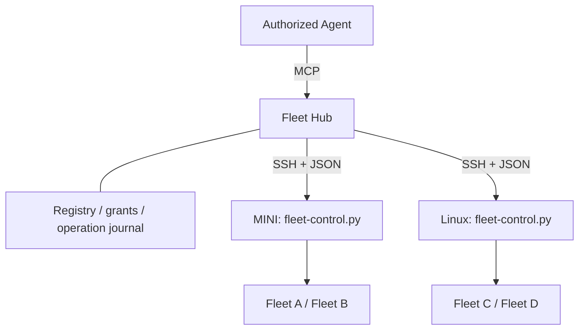

# Fleet Hub: one MCP endpoint for registered machines

Fleet Hub is an optional control service for managing several machines' Fleets
through one MCP connection. It keeps a machine/Fleet registry, expiring caller
grants, an operation journal and an audit trail. Each machine continues running
its own workers. The Hub invokes a fixed JSON control entry point over SSH;
nodes do not need a new network listener or the MCP SDK.

The Hub supports discovery, status, issue-worker starts, three explicitly
allowed configuration keys, and — on a durable worker identity — messaging,
graceful stop and resume. It is opt-in: installing the files does not start a
service, register machines or grant anyone access.

> **Single machine / offline use.** For several machines, use the cloud hub
> instead: `ccquota hub` with `CCQUOTA_FLEET=1` (`tokenledger/`, issue #1409)
> keeps the same registry, fleet UUIDs and worker_ids (derived by the same rules,
> checked value for value), fed by each machine's own outbound control channel
> rather than by SSH from the hub — and serves `fleet_list` / `fleet_status` /
> `config_get` / `operation_get` (plus `fleet_sessions`) over its MCP endpoint,
> and every write tool below with the same journal semantics (issue #1410). Its
> `worker_start` can also omit `fleet_id`: `node=auto` places the start on the
> caller's least-loaded machine — the tighter of CPU and memory idle; account
> quota is shared by every machine and never scored (issue #1994) — under a
> per-person cap per machine only where one is set (`fleet.node_cap.<machine>`,
> no default), and journals why.
> This Python hub is kept as is for one machine, or when the cloud hub is out of
> reach. See `tokenledger/README.md`, "Sessions on every machine".

Here, **Fleet Hub** means the cross-machine control service. The existing `plan`
hub window remains the per-Fleet dashboard; it is not this service.



## Interfaces and identity

`bin/fleet-hub.py` provides the administrator CLI and the MCP server.
`bin/fleet-control.py rpc` handles one JSON request on stdin and returns one JSON
response on stdout. Diagnostics must never be written into either protocol's
stdout. `fleet-control-read.sh` adapts the existing Fleet helpers.

Each node persists a random machine UUID in
`$FLEET_CONF_DIR/control/state.sqlite3`. Its Fleet IDs are UUIDs derived from that
machine UUID, the configured session name, repository and checkout. Restarting
the Hub or a tmux server preserves IDs. Changing a Fleet's name, repository or
checkout produces a new ID and requires a new grant. Copying a node's control
database to a different machine is not a supported enrollment procedure.

Names such as `MINI` are display names. MCP operations use a Fleet UUID, never a
hostname supplied by an Agent. SSH aliases and local configuration directories
are administrator-owned registry data. Registration pins the node UUID; later
responses from a different node identity are refused. OpenSSH host-key checking
is required independently of this application-level identity check.

### Worker identity

A node's own request (`/v1/node/*`, a relay) speaks for the machine and login. One
made **for one of its sessions** — the session's tool service verified its worker
credential first — also carries a node-signed worker assertion (`X-Fleet-Worker`
on `/v1/node/place`, `worker` on a relay; issue #1810): the hub verifies it
against the node's token hash (401 if it does not hold), keeps the call to that
session (404 otherwise), and writes its `worker_id` into `fleet_audit` and the
operation journal. Spec: [FLEET-MCP.md](FLEET-MCP.md) «The hub route».

`fleet_status` returns two kinds of value per worker, side by side:

- `worker_id` — the **durable identity**: `<fleet UUID>/issue-<N>` for a worker
  bound to an Issue, `<fleet UUID>/scratch-<N>` for a raw scratch session. It is
  built from the binding the fleet itself keys every `/fleet-history` row and
  ledger-watch snapshot on (`@issue`, or the scratch worktree slug), so it
  survives a `/fleet-handoff` (same window, new native session), an account
  migration (new window, `@issue` re-bound), `renumber-windows` and a tmux server
  restart. A window whose scratch worktree cannot be resolved has `worker_id`
  `null` and cannot be addressed. In a fleet hosting **two or more repos** the key
  carries the window's repo slug — `<fleet UUID>/<owner-name>:issue-<N>` (issue
  #1018; the `<slug>:issue-<N>` spelling of #789) — because two hosted repos can
  both have an issue-12; each worker also reports its `repo`. A window whose repo
  is unknown there gets `worker_id` `null`, never a guessed one. A one-repo
  fleet's keys stay bare. A bare `issue-<N>` sent to a multi-repo fleet matches
  every repo's window and is refused as `AMBIGUOUS` when more than one holds it.
- `identity` — the session's **lifelong** identity (issue #1646): its window's
  `@fleet_id`, a UUID minted once when the session is spawned and carried
  verbatim by every restore, migration and move (local or through the hub, in
  the transcript bundle as `<sid>.fleet-id`); never re-minted, untouched by
  `/clear` and a handoff. A key can change under a live session — a scratch bound
  to an issue stops answering to `scratch-<N>` — the identity
  cannot. `<fleet UUID>/<identity>` is a worker_id too, accepted wherever one is
  (`worker_*`, relays, `origin_wid`), and the worker map lists every worker
  under both. A spawn records its parent's as `@origin_fid` (and
  `@origin_wid` = `<fleet UUID>/<parent identity>`); `fleet-report-parent.sh`,
  `fleet_worker_locate`, the peer channel and the inbound relay resolve the
  identity first and fall back to the key, and `fleet_origin_heal` re-points a
  child's `@origin` at its parent's current key, so everything that joins on keys
  follows. The key form stays an alias for one version (EPIC #1645 rule 2);
  `worker_id` in the inventory is still the key form, and a lease, a placement
  and a move still name a key.
- `window_id`, `handle` — **observations** of where that identity lives right
  now. They are re-minted by every migration and restore and are
  never accepted as a target.

`worker_message`, `worker_stop`, `worker_resume`, `worker_answer`,
`worker_reap`, `worker_switch`, `worker_rename`, `worker_reap_policy`, `worker_pin` and `worker_transfer` take
the `worker_id`. The
node re-resolves it against the fleet's live windows at the moment it acts and
refuses (`NOT_FOUND`, `AMBIGUOUS`) unless exactly one window holds it — a window
that merely has the number a caller last saw is never touched. `lifecycle`
reports hibernation (`awake`, `preparing`, `sleeping`, `waking`, `failed`); a
sleeping worker is refused (`INVALID_STATE`) rather than typed at, because the
sleep controller owns its pane. Transfer between machines is still deferred.

**Inside a fleet** (issue #1420) the same identity is the cross-machine address.
`fleet_worker_locate` (`bin/fleet-lib.sh`) answers `local <window> <sess>`,
`remote <node>` or `unknown` for a `worker_id` (or a bare key, meaning this
fleet); `fleet_uuid` mints the same fleet UUID as the controller, read-only.
`fleet-peer-send.sh`, `fleet-await.sh` and `fleet-answer.sh` take a
`wid:<worker_id>` target, and every spawn stamps the parent's worker_id as
`@origin_wid` beside `@origin` for `fleet-report-parent.sh`. A local hit runs the
existing path unchanged; `remote` and `unknown` refuse with the reason and never
fall back to a local window that shares the number. Only with `CCQUOTA_FLEET=1`
does a miss consult the hub, and then only through the local cache
`$FLEET_CONF_DIR/control/hub-workers.tsv` (`<worker_id>\t<node>`, fresh for
`FLEET_HUB_CACHE_SECS`, 30 s, refreshed by `FLEET_HUB_STATUS_CMD`); with no fresh
cache the fleet behaves as a one-machine fleet and says so on stderr.

**Across machines** (issue #1421, EPIC #1419 C2) the cloud hub carries what the
remote branches above used to refuse. Nothing in `bin/` dials the network: the
ccquota agent's control channel is this machine's only door to the hub.

- **The map.** After heartbeats the hub pushes each relay-capable node its owner's
  worker map — every worker on every machine, with its machine (`mac-a`, or `mac-a:lost`)
  and its parent's worker_id (the inventory's `@origin_wid` column, #1423) — and the
  agent writes it as `hub-workers.tsv` (`<worker_id>\t<node>\t<parent wid>`).
- **The outbox.** `fleet-report-parent.sh` (a parent elsewhere) and
  `fleet-peer-send.sh` (`wid:` of a worker elsewhere) drop a relay —
  `{id, kind, from, to, payload}`, id = `<sender worker_id>#<n>` — in
  `$FLEET_CONF_DIR/control/hub-outbox/` (`fleet_hub_put`). The agent sends it as a
  control-channel `relay`; the hub checks the sender's fleet is that node's and the
  target's belongs to the same owner, STORES it (the id is the key: a resend is a
  no-op) and acks, and the agent deletes the file. A refusal is kept in `refused/`.
- **Delivery.** The hub pushes the relay down the target node's channel — at once,
  or when that node reconnects (pending relays expire after 7 days) — and that
  agent runs `bin/fleet-hub-node.sh deliver`: a `child_report` is appended to the
  parent's ledger there with `node` + `rid` (one row however often it arrives) and
  delivered like a local report (tier, batch mode, `children_send`); a `message`
  goes to the worker through `fleet-peer-send.sh`, prefixed `[from <key> on <node>]`.
- **Queued for the recipient** (issue #1647). A recipient not live on its machine
  makes `deliver` answer «not now» (75): the hub keeps the relay and pushes it again
  only on a beat whose inventory lists that worker — by `<fleet>/<key>` or its
  lifelong `<fleet>/<fleet_id>` — never on a timer alone. A recipient whose window is
  there but cannot take it (no live Claude, an inbox that will not answer) gets it
  through that machine's peer queue (`bin/fleet-peer-queue.sh`, drained by the
  cleanup tick and a sleeper's wake). The sender hands a full worker_id over even
  when its map is stale — the hub routes on the fleet UUID — and says
  `queued → …` (exit 3) unless the hub's **receipt** says delivered within
  `FLEET_HUB_RECEIPT_WAIT` (10 s — the round trip is 4–7 s on a loaded pair of
  machines; every tier waits, a silent report's receipt meaning «in the parent's
  ledger», issue T756): once a relay settles (delivered / failed /
  expired after 7 days) the hub pushes a `receipt` relay back down the SENDER's
  channel, and its `deliver` writes the row into that fleet's delivery book,
  `fleets/<sess>/delivery.ndjson` (`QUEUED` → `DELIVERED` / `FAILED` / `EXPIRED`).
  `reported` / `sent` therefore always means it arrived; a receipt that says the
  target's machine merely holds it stays `QUEUED`. A send whose last word is still
  `QUEUED` after `FLEET_PEER_QUEUE_ALERT_SECS` (60 s) is said once in ⌘P's 消息 by
  the cleanup tick (`fleet-peer-queue.sh stale`, T756).
- **One progress stream per parent** (issue #1648). The hub appends, under the
  parent's worker_id, every state of a placement it made for it (the `worker_start`
  operation: `accepted` → `running` → `done` / `refused` / `failed`) and every
  `child_report` relayed to it (table `fleet_progress`, 30 days; a report's `rid` is
  its relay id, an operation's `op:<id>:<state>`). The parent's machine pulls it —
  `fleet-hub-node.sh progress` (`GET /v1/node/progress?since=<seq>[&ops=…]`, the
  node token; the cleanup tick, and `fleet-children.sh` at most every
  `FLEET_PROGRESS_MAX_AGE` s) — into its book, deduped on `rid`: a report the push
  already delivered is one row, a placement's later state a new `.dispatch` row,
  and the placements a book still holds open ride along as `ops=` so the hub asks
  their machine once more (an `--async` start reaches its final state too). The
  pull only APPENDS — delivery into a pane stays the push's. `fleet-children.sh`
  folds the three sources into ONE row per child with a `progress` word
  (accepted / starting / running / pr / merged / reaped / failed / blocked /
  refused); a placement with no report yet is that row, not a `↗` line of its own;
  and a later STOPPED / IDLE / WAITING never un-lands a MERGED (nor a PR the
  prmap calls merged). Hub off, no node token, `FLEET_HUB_PROGRESS=0` or a
  hub without the endpoint ⇒ exit 3, nothing asked, nothing written.
- **Waiting and holding.** `fleet-await.sh wid:<child elsewhere>` (a child whose
  parent is you) waits on your ledger, which the hub feeds, and calls it GONE when
  the map drops it. `fleet-children.sh` lists a remote child as `mac-a remote` (or
  `gone · mac-a`), and `fleet_window_waiting_children` — the reaper's
  `retained:children` — counts a remote child until its MERGED report arrives,
  skipping a lost node and any map older than `FLEET_HUB_RETAIN_SECS` (600 s).

Switch it on with `CCQUOTA_FLEET=1` in the fleet's conf (the agent needs the same
variable, which it already has when it reports to a fleet hub). Off, or with no
running agent, every script behaves as it did before. The switch is read **per
fleet** (issue #1539, `fleet_hub_on`): a fleet conf's own line wins over the
login-wide `export CCQUOTA_FLEET=1`, both ways, and a conf without the line
follows the login — see [LOCAL-AND-HUB.md](LOCAL-AND-HUB.md) for which switch
lives at which level.

**The sidebar sees every machine** (issue #1423). With `CCQUOTA_FLEET=1` and
`CCQUOTA_HUB_URL` set, the collector keeps `bin/fleet-hub-sessions.sh` refreshing
the hub's `fleet_sessions` into `global/remote_<sess>` (and the
`control/hub-workers.tsv` cache above) — every 2 s while a client is attached to
a fleet session on this machine (`FLEET_HUB_SESSIONS_WATCHED_EVERY`), every 10 s
when nobody is looking (`FLEET_HUB_SESSIONS_EVERY`). `tmux-dashboard-rows.sh` only reads that
file: your sessions on other machines — your login, a `worker_id`, a fleet that is
not this machine's — render mixed in with the local windows, nested by
`@origin_wid` (or the issue's sub-issue parent), and **look exactly like the
local rows** (issue #1475, the operator's call: no `[mac-a]` prefix, no machine
tag — the machine is the row menu's title, `侧边栏 · 在 mac-a`, and the status line
on top). Their window id is `wid:<worker_id>`, so reap, rename, pin and fold
find no window: remote rows are read-only; Enter (or the menu's `e`) opens the
proxy window below. Their red `?` / `⊘` (asking you, waiting for a
permission) is the local one: the inventory's column 12 carries `@claude_needs`.
The **machine status line** heads the sidebar (and the hub list):
`● mac-b 22 · ● mac-a 3` — one entry per machine, `●` online / `◐` 维护中 (the
operator's flag before a planned outage, issue #1427: heard, no new work sent
there, rows unchanged) / `○` lost with `N 分钟没联系`, and your session count there; the local count is the frame's own
rows, the others come from the cache's `#node` lines (the hub's `nodes` list,
derived from the sessions on an older hub). A machine the hub calls lost, or a
cache older than `FLEET_HUB_SESSIONS_STALE` (60 s), keeps its rows — dimmed,
un-nested, in their own group at the foot under a `─ mac-a 失联 3 分钟 ─` heading —
never vanishes — and since #1483 the same holds when the HUB is the silent one
(`global/hub_ok`, below). Machine labels come from `FLEET_NODE_ALIASES`
(`mac-c=mac-b mac-d=mac-a`). To feed the nesting, the controller's worker inventory
carries each window's `name`, `origin_wid` and `needs` (columns 10–12 of
`fleet-control-read.sh workers`, optional).

**…and can be the whole list** (issue #1480, EPIC #1479 C1). The cache now holds
this machine's own rows too — two fields appended to each line: `local` (1 for a
row of this fleet on this machine) and `wid` (the tmux window id that holds it
right now, mapped once per refresh from `fleet-control-read.sh workers` through
the same `worker_key` rule the node agent reports with, never from the hub's
observation) — and a local row goes only into its own fleet's cache. With
`FLEET_SIDEBAR_SOURCE=hub` (per fleet, default `local`) `tmux-dashboard-rows.sh
--sidebar` takes its row SET from the cache alone, so every machine shows one
list in one order with one set of marks; a local row is still rendered off its
own tmux line (state, needs, glyph, fold, pin, Enter: today's row, and its id is
its `@<n>` window, never a `wid:`), a local window the hub does not list is not a
row — the sidebar's own window, a pinned window and a `@norepo` session excepted
(issue #1643: the hub never lists those, a no-repo session has no worker_id and a
pin is this machine's own mark, so the pinned guide vanished with the switch) —
and a cached local row whose window is gone is not one either. On the default source the cache's local rows are skipped
and nothing changes; the hub list (prefix+F9) always keeps its local rows.

**The status bar reads the session you are on, and draws only what wants your
hand** (issues #1482, #1616; EPIC #1479 C3, EPIC #1615 C1). In hub mode —
`CCQUOTA_FLEET=1`, the fleet's `FLEET_SIDEBAR_SOURCE=hub`, and a `remote_<sess>`
cache on disk — the bar's right side is about THE WINDOW YOU ARE ON, not this
machine, and it is EMPTY while all is well. Each segment appears on its own
condition, in this order: `旧` when a machine's live install is behind stable (this machine's own
row too); the window's `@cc_account` once max(5h, 周) reaches
`FLEET_STATUS_QUOTA_PCT` (80 %; off the hub's limits, else the window's own
`@rl5h`/`@rl7d`); the alert counts; `○ 入口 Nm` once `global/hub_ok` (#1483,
below) is older than `FLEET_HUB_SESSIONS_STALE`. Below 60 columns the account's
label goes and only the higher window stays. Load and memory are no longer drawn
— `fleet-alerts.sh` raises `▲ machine · load high` / `memory high` when they turn
red. Colours from `conf/fleet-palette.conf`. The window list
(`window-status-format`) goes blank in hub mode and is restored on leaving
(saved in `@status_wsf_saved` / `@status_wscf_saved`, flag `@status_wlist_saved`).
The conf's `status-right` passes the client's current window as `k=v` args
(`sess= win= remote= acct= wsf= wscf= wsaved= cw= rl5= rl7=`), so tmux re-runs the bar the
moment you switch windows. Data: the same refresh loop writes, every
`FLEET_HUB_SUMMARY_EVERY` (10 s, whatever the sessions' pace), `global/hub_nodes` (`/v1/nodes`: `node online|lost load1 ncpu mem_pct sessions
fleet_version age mem_used_mb mem_total_mb ver_state`) and `global/hub_limits`
(`/v1/limits?account=all`: `label pct5h pctweek account_uuid hub_label`, the
label being this login's `accounts/<label>.conf` whose `CCQUOTA_ACCOUNT` is that
uuid, else the hub's). Beside `hub_nodes` it writes `global/hub_repos` (#1927):
every machine's `repos` — the repos its registered fleets host, narrowed like the
machines — one `owner/name` per line, which the client's list offers as the repo
of a first session while it shows no repo heading yet (no file from a hub older
than `repos`). Both are viewer routes; a login whose identity (the
#1475 ladder) is a connection certificate asks the hub's cert door instead —
`POST /v1/fleet/summary` (#1502), signed under `fleet-summary@claude-fleet` like
the session list, ONE body carrying both `machines` and `per_account`, narrowed
by the hub to the machines of the person's ACTIVE logins and the subscriptions
those logins report under (no `endpoint_shares`), audited as `fleet_summary`. So
a colleague who only did `fleet login` gets the machine's word and their own
account's quota. Only a refusal (401/403, or 404 from a hub not yet redeployed)
falls back to the viewer routes with the token; no answer spends nothing.
Off hub mode
the bar draws the account past the line (off the window's own reading), the
alert counts and nothing else.

**The hub gone is not a blank screen** (issue #1483, EPIC #1479 C4). 入口通不通
is ONE word: `global/hub_ok`, the epoch of the last `fleet_sessions` round that
stood (a 200 taken, a 304 restamped), written by `fleet-hub-sessions.sh` and
nothing else — a failed round leaves it, so its age IS the silence (the loop's
stderr says `hub unreachable for Ns`). Every reader goes through
`fleet_status_hub_ok` / `fleet_status_hub_lost` (`bin/fleet-status-lib.sh`; a
cache from before the file is judged by its own `#ts`, as it always was), none
probes the hub: older than `FLEET_HUB_SESSIONS_STALE` (60 s) ⇒ 失联. Then the
sidebar keeps the last list — the other machines' rows dimmed where they
stand, each ending in `@mac-a!` (issue #1882: no group of their own, the list
does not move) — and on the hub
source this machine's rows come from tmux again (the local-source code, so a
window opened or closed meanwhile shows at once, and a row's state is its live
state as always: the hub's word on WHICH local rows exist is as old as its
silence, this machine's tmux is not); the bar reads `入口 ○ 失联 Nm`, a proxy
window's machine `mac-a ○ 失联 Nm` (nothing here can hear it; a machine the hub had
already called lost keeps its own, longer silence) and a local window's chip its
live readings; a remote row's menu is titled `… · 入口失联 Nm`, «新建到 mac-a…» is
greyed with the reason, and every action on a remote row refuses with a toast
(`fleet-row-remote.sh`: 「入口失联 Nm，稍后再试」) instead of a 40-second
timeout — Enter on the row (the proxy, a direct ssh) still works. The next
round that stands rewrites `hub_ok` and everything flips back on its own;
nothing is restarted. Off hub mode nothing changes; with the hub off the file is
never written. `dash-remote-rows-selftest.sh` leg L, `tmux-status-selftest.sh`
legs E/G and `fleet-view-selftest.sh` pin it.

**One person, several clients** (issue #1715, EPIC #1710 C5; #1932, EPIC #1906
C13). The hub keeps a client lease per CLIENT, in memory, at most 4 a person
(`FLEET_CLIENT_MAX` in the hub's environment): `POST /v1/fleet/client` `{action:
acquire|renew|input|release|list|revoke|get, lease, device, terminal, version,
last_input, viewing, target}`, signed under `fleet-client@claude-fleet` like the
session list (a viewer door may GET). `fleet_thin_lease.py` on the home machine maintains a lease for each
attached thin view; 45 s without a renewal and it lapses. A second client of the same
person — a MacBook, then an iPhone, then an iPad — takes a lease of its OWN, with
its own action key: nobody goes to standby. The **primary** is the client typed
into or tapped last: the keeper reads tmux's `#{client_activity}` every 5 s
(`FLEET_CLIENT_INPUT_EVERY`) and, when it moved, sends `input` (≤ 1 per 5 s) with
that client's where; a client with no input for `FLEET_CLIENT_IDLE` (10 min) is
not primary while another is in use (all idle → the latest input still wins);
opening a client counts as input. `get` — and `GET /v1/node/client`,
`ClientLeaseOf` — answers the primary as `lease` with `clients` (every live one,
the primary marked) and `primary` beside it, so a reader of one lease reads what
it always did. Actions (`/v1/node/client/actions`) go to the primary; a `notify`
with `all` goes to every client. Past the limit, an acquire asks the client used
least recently to leave (a lapsed lease goes first, quietly): it reads
`taken_over` with `reason: evicted` on its next renewal and its screen says
「客户端已开满…（最久没用）· 按回车重新连上」. `revoke {target}` — the client's
「我的客户端」 menu (`bin/fleet-client-menu.sh`) — drops another of your clients'
lease and action key at once (an action signed with it is refused 401), and that
client reads `taken_over` / `revoked`: 「这台已在「我的客户端」里被断开」. In
standby the list's refresh loop asks the hub nothing, `fleet-hub-write.sh`
refuses, the warm loop opens nothing and the keeper stops renewing; Enter is an
acquire again. On one machine a second `fleet` attaches to the running server
(never a second one) and both clients simply work; the one typed into last is
that server's where. A renewal also carries `viewing` (the worker id the stage
shows) — the top line no longer says 「也在 iPhone 上打开」 (issue #3194). A lapsed lease (a MacBook asleep) carries on when it
wakes unless it was asked to leave. A server that ends releases its lease. An
older hub (one lease a person) still answers `taken_over` with no reason, and the
old screen 「正在 <device> 上使用 · 按回车接回」 shows. A hub restart forgets
every lease and each live client's next renewal re-adopts its own id while there
is room — and, since every renewal carries the where in use on that server
(`client.where.json`: device, terminal, os, via, host, caps, plus the version),
the re-adopted lease knows its device again at once, each client its own (#1995;
`TestClientLeaseRenewRefillsAfterRestart`, BREAK-IT `hub-restart-where`); no hub URL (or a hub without the route, a 404) → no lease.
`TestFleetClientLeaseByCertificate` / `TestClientLeaseTableSeveral` and
`bin/fleet-client-lease-selftest.sh` pin it.

**Where the person is** (issue #1716, EPIC #1710 C6). The lease also carries
`os`, `via` (`local` · `tailnet` · `lan` · `public`), `host` (the machine the
client runs on) and `caps` (`open_url` `show_file` `notify` on the device itself;
`link` for a device at the far end of an ssh; `iterm2` added in an iTerm2), all
worked out ONCE when the client opens (`fleet-client-lease.py device`, saved per
tty as `<cache>/tmp/client.where/<tty>.json`) off the connection itself — no key,
no name anyone gave it: a tailnet source address → `tailscale whois` (device +
system); a LAN one → matched against the LAN endpoints tailnet devices report
(`tailscale status`); a public one (port 22022) → 未知设备. The terminal:
`LC_TERMINAL[_VERSION]` (macOS's ssh sends `LC_*`; iTerm2 sets it), else
`TERM_PROGRAM`, else an XTVERSION query (`CSI > q`, 200 ms, bounded by a DA1),
else 通用终端 (`TERM`). A node reads its OWNER's lease with its own token at
`GET /v1/node/client` (owner = `PrincipalForLogin`, unowned = the operator's).
**`bin/fleet-client-where.sh` is the one reader** (EPIC rule 7): the hub's lease,
or with no hub the thin view attached here; one line, or `--json` `{state device os terminal caps since via
host source}`; exit 0 named · 3 nobody connected · 1 could not tell. Nothing is
cached, so a takeover shows on the next call. The fleet mod (`mod/fleet/hooks/where.ts`)
reads it at session start and every 15 s and keeps it as the last `session`
section of the system prompt (「操作者此刻在：…」); Codex reads the same script
through the agent-defaults block. `TestNodeClientReadsOwnersLease`,
`bin/fleet-client-where-selftest.sh` and `mod/fleet/tests/where.test.ts` pin it.

**Open it on the device in your hands** (issue #1717, EPIC #1710 C7). A session
anywhere that runs `fleet-open.sh` / `fleet-show.sh` first asks
`fleet-client-where.sh`. A client holding the lease → the page or file goes to
THAT client through the hub, never through the session's terminal: the node
`POST /v1/node/client/actions` `{kind: open_url|show_file|notify, url | rport
path scheme, file name size inline, title body, links {tailnet, hub}, wait}` with
its own token (to its owner's lease, the C6 rule; `bin/fleet-client-actions.py
send`). This hub door remains for compatibility with previous releases.
The removed client's action loop used to long-poll `POST /v1/fleet/client/actions`
`{action: poll|done, lease}` with its connection certificate and does it on its
own device: `open` / `xdg-open` (caps `open_url` / `show_file`); a page on the
session's machine's loopback (`rport`) first forwarded over the client's ssh
master to that machine (the warm one, else its own); a file fetched from that
machine (`cat` over the master) into `~/Downloads`; an iTerm2 at the far end of
an ssh (caps `iterm2`, no `open_url`) through `fleet-open.sh` / `fleet-show.sh` /
OSC 9 on that terminal; a phone (caps `link` only) never opens anything — a line
at the bottom of the client with a link to tap: the page's tailnet address
(`tailscale serve`, worked out by `fleet-open-addr.py`) for a
device on the tailnet, the hub's (`links.hub`) for one that is not, the URL
itself for a page elsewhere, or 「回到电脑上再看」 with the link kept in
`links.pending`. **Anti-forgery** — open.secret's rule on this road: every action
is signed (HMAC-SHA256 over the payload) under its lease's action key, which the
hub hands only to the lease's own client on acquire / renewal (`action_key`,
written 0600 to `<cache>/tmp/client.key`, never on a read or to a node), and
carries the lease id; the client runs one only when the signature checks, the
lease is its own, it is under 5 minutes old and not a replay — anything else is
logged `refused: …` and dropped. The machine an action came from is the hub's
word (the node's roster name), not the body's. A takeover drops what was queued
for the old lease. Every action is one line in `<cache>/tmp/actions.log`. No hub
and the one client here runs on this computer's own screen → `open` right here
(`opened`); nobody connected → the terminal road, unchanged. Since #3538 fleet-open
prints a receipt word — `opened` · `failed:<why>` · `unconfirmed` — and a client's
`done` / `failed` IS the receipt. There is no
hub page proxy yet, so a loopback page on a phone off the tailnet gets
「回到电脑上再看」. `TestClientActionsReachTheOwnersLeaseSigned` and
`bin/fleet-client-actions-selftest.sh` pin it.

**Who the hub shows you** (issue #1475). `fleet-hub-sessions.sh` asks as **you**:
your connection certificate (`~/.ssh/fleet-cert` + `-cert.pub`, from
`fleet login`, `FLEET_CERT` to name another) signs `fleet-sessions <ts>` under
`fleet-sessions@claude-fleet` — the `/v1/fleet/routes` protocol of #1414 — and
POSTs it to `/v1/fleet/fleet_sessions`, which now sits outside the viewer gate
(`handleFleetSessions`) and admits a certificate the way the routes do; the
holder is then a fleet principal, scoped by `FleetScope` to the machines of their
ACTIVE accounts. So a colleague's sidebar fills in right after `fleet login`, no
token anywhere. No certificate, or one past its validity (`ssh-keygen -L`'s
window, checked locally), falls back to the viewer token (the operator's); a
certificate the hub refuses (401) falls back too; neither ⇒ nothing is fetched,
no remote row, and `fleet-doctor`'s `hub` line WARNs.
`fleet-hub-sessions.sh --identity` prints which it is. The hub URL is
`CCQUOTA_HUB_URL`, else `FLEET_HUB_URL`, else `hub.json`'s `url`.

**A state change is reported at once** (issue #1481, EPIC #1479 C2). The node
agent's heartbeat stays at 5 s — that is the liveness signal — but a window that
just went 「在问你 / 等授权 / 做完了」 no longer waits for it: every writer of
`@claude_state` / `@claude_needs` calls `fleet_hub_nudge` (`bin/fleet-lib.sh`;
`bin/set-claude-state.sh` and `bin/tmux-spinner.sh` carry an inline copy) right
after a write that *changes* them, which touches `$FLEET_CONF_DIR/global/hub-nudge`
— one file per login, the agent's scope. The agent polls that file's mtime every
250 ms (no fsnotify) and sends an extra heartbeat: 100 ms debounce (300 ms before #1526), so a burst
of writes is one beat, and at most two nudge beats a second per node, so no
writer can flood the hub. Off without `CCQUOTA_FLEET=1`: the function is empty.
On the fetch side `fleet_sessions` carries a validator: `ETag` =
`"<newest observed_at, ms>-<rows>-<rows on a lost machine>"` (also `etag` in
the body), so any heartbeat moves it; a `GET` with a matching `If-None-Match` is
answered `304` with no body. `fleet-hub-sessions.sh` sends the validator it
stored (`global/hubsess.etag`) whenever every cache it vouches for is on disk,
and treats a 304 as «the rows stand»: it re-stamps the cache's `#ts` line (and
`hub-workers.tsv`'s mtime) so nothing reads 失联 while the hub is answering. A
hub without ETags is fetched in full every time, as before.

**One session list** (claude-fleet A4G2). A person's `fleet_sessions` answer (their
own rows — a member, an admin on a daily route, a node token's person; everything
at the operator's door; never an admin's everyone's view) also carries `board`:
the list the console's 会话 and the ⌘P panel both draw, built once by
`buildBoard` (`tokenledger/hub/api/fleet_board.go`). A row is one piece of work
keyed by its session's ID — a version-1 record's own ID is its window's
`@fleet_id`, so a record and the session doing it are one row even though the
record never learned a worker_id. Groups 置顶 · 等你 · 在干活 · 排队中 · 已收起
(近 7 天, an exited agent's window included, never counted), newest first, an
EPIC's members under their parent, `count` over the first four on machines not
lost; the board's digest is folded into the ETag. The panel takes it from
`global/hubsess.body` while `hub_ok` is fresh (`fleet_view.board_apply`; stale or
absent ⇒ its own list, `FLEET_VIEW_BOARD=0` to switch off); `fleet board diff`
(`bin/fleet-board-diff.py`, the doctor's `board` row) prints how far the two are
apart. A record ends with its session: an ID closing with no result cancels it
(「结束·没交回结果」, `id_closed:`), `reopened` puts it back, a later result wins,
and the alerts leader sweeps every 5 min (`ReconcileClosedTasks`: closed before,
never started within 24 h) — BREAK-IT `task-record-never-closes`.

**…and the watcher is told at once** (issue #1526, EPIC #1524 C7). While someone
is looking and a validator is held, the ask also carries `wait` (seconds, ≤ 25 —
under an ingress's 60 s idle timeout): `?wait=` on the token's `GET`, a `"wait"`
field in the certificate's `POST` body. With a matching `If-None-Match` the hub
holds the request (`fleetSessionsWait`, `tokenledger/hub/api/fleet_longpoll.go`)
and answers `200` the moment a recorded heartbeat moves the validator — every
`recordFleets` fires a broadcast that wakes the held asks, which re-read and go
back to waiting if *their* answer did not move; a 5 s recheck catches a machine
going lost by silence — or `304` at the deadline. `fleet-hub-sessions.sh --loop`
asks again at once after a 200 or a held 304; an immediate 304 or a failure (an
older hub ignores `wait`) keeps the 2 s cadence. No `wait`, no validator, nobody
looking, or `FLEET_HUB_SESSIONS_LONGPOLL=0`: the request and its answer are
what they were. Budget: a change on machine A reaches machine B's list in ≈ 0.5 s
(≈ 0.125 mean poll + 0.1 debounce + the beat + the held answer + the cache
write; it was ≤ 3 s with the 2 s cadence).

**…and acts on them** (issue #1487, EPIC #1479 C8). A remote row's menu (`.` /
a second tap; `fleet_view.py`) offers what a local row's does — 发消息 ·
答授权 / 回答 · 停 · 继续 · 回收 — and every one is a hub WRITE: the item runs
`bin/fleet-row-remote.sh <action>` (the asking: a popup for the message text
and for the answer — `[y]` 批准 / `[n]` 拒绝 on a `⊘` row, the option number on a
`?` row; a `confirm-before` on reap, naming the machine; a toast with the
outcome, the node's refusal verbatim), which calls **`bin/fleet-hub-write.sh
<tool> <json>`** — the ONE client that writes to the hub, from a node or from
the C5 shell. It fills in an idempotency key (`--idem` to name one; a retry is
the same operation), posts, and `--wait` reads `operation_get` back until the
operation is terminal. Who writes, in order: `FLEET_HUB_WRITE_CMD` (a seam),
on a NODE this login's **node token** (issue #3106: `POST /v1/fleet/write
{tool, args_json}` with the bearer — node.env's at its hub, or a separated
login's credential-proxy broker pair, `fleet_node_pair`; the hub reads it as the
login's OWNER through `nodeLoginIdentity`, so `FleetScope` cuts the target to
their own workers, admits the worker tools only (`nodeWriteTools`) and writes a
`fleet.node_write` hub-audit row naming the machine — a node's own daemons never
borrow a person's 12-hour certificate; a 401 / 404 falls through when one of the
next doors is here), the viewer token (`POST /v1/fleet/<tool>` — the operator's door on a node), else
**this device's connection certificate**: `POST /v1/fleet/write {cert, sig, ts,
tool, args_json}` with `ssh-keygen -Y sign -n fleet-write@claude-fleet` over
`fleet-write <ts> <tool> <sha256(args_json)>` (`handleFleetWrite`, outside the
viewer gate like `fleet_sessions`) — the signature binds THIS write, so a
captured one is good for nothing else, and the hub then acts as the
certificate's person: their own workers only (`FleetScope`; another person's is
`NOT_FOUND`), their grant (`DefaultPersonScopes` holds `worker:answer` and
`worker:reap`), their principal in the journal and the audit row. The same door
takes `operation_get`, so the shell reads its outcome with no token anywhere. A
local row's items are untouched, and with the hub off none of this exists: the
menu offers these only on `wid:` rows, which only the hub's cache produces.

**The client on your own computer** (#3008). `bin/fleet` opens
`fleet-thin.py`: one foreground loop and one connection to the home machine.
It writes the iTerm2 profile on a Mac, forwards portable keys, and reconnects
using the view's current session identity. The home draws the panel and bar;
its peerlink daemon owns the connections to other (machine, login) pairs.
`fleet connect` remains the route/ssh diagnostic entry. See [CLIENT.md](CLIENT.md).

**The one-line install carries the shell** (issue #1486, EPIC #1479 C7; it
is the ONE install line and asks 只看只派 / 承载 and 接 / 不接, everything in
`~/.claude/fleet` — issue #1804; with no hub at all, the same script from
GitHub's `stable`, answered 「不接」 — issue #1712,
[LOCAL-AND-HUB.md](LOCAL-AND-HUB.md#一条安装命令issue-1804)).
`curl -fsSL <hub>/install | sh` fetches `/install/manifest` — the list the hub's
image embeds (`tokenledger/hub/api/fleetclient/manifest`, the ONE place the
client's file set is maintained) — then `/install/<path>` for each, SHA-256
checked, into `~/.claude/fleet/<path>` (the one directory, #1804): `bin/fleet`,
`fleet-login.py`, `fleet-connect.py`, `fleet-thin.py` and its shared modules.
`bin/` and `conf/` are canonical; `fleet-client-pack.sh` copies the manifest's
files into the ignored Go embed directory before the hub build.
`fleet-client-mirror.sh --check` verifies that every packaged path exists;
`TestFleetClientMatchesBin` and `fleet-install-selftest.sh` check the package.
The hub image is deployed by
hand — but a client does NOT wait for it (issue #1805): every computer follows
`refs/tags/stable`. The hub learns what stable names from the CI's publish
(issue #2772, below), else from an upstream hub's signed releases
(`CCQUOTA_FLEET_UPSTREAM_HUB`, issue #4847, below), else — only when
`CCQUOTA_FLEET_STABLE_REPO` names a repo — by looking it up on GitHub every 5
minutes (unset or `off`: never), and reports it on `/version` as `client_version` + `stable` +
`client_url` (`<hub>/install/stable/<sha>`, the repo's client files at that
commit fetched once from GitHub's raw host and kept — only shas stable has
named, only the client's paths), and `/install` serves stable's own installer
when it carries the `fleet-install: stable-aware` line. A client compares, stages
in the background and switches when idle, as before; with no hub it asks
GitHub's API directly. A hub that never reached GitHub hands out the image's
packed client, exactly as before. So moving stable is the whole release; the
image is redeployed only for the hub's own changes. `fleet update` on any
computer says where it stands.
Which commit the deployed image was built from is public on `GET /version`
(`{"version":"prod-<sha>","commit":"<sha>"}`, issue #1696 — the commit is the
hex run that ends the Dockerfile's `VERSION` build arg, so build with
`VERSION=prod-$(git rev-parse --short HEAD)`), and `fleet-doctor`'s `hub-image`
row compares it with `refs/tags/stable` (`bin/fleet-hub-image.sh`): WARN with the
count when the hub hands out a client older than stable, INFO otherwise — no
cluster access, no token.

**Machines take stable from the hub, signed** (issue #2335, EPIC #2329 C7). Each
time the hub sees stable move it builds a **node release** for that commit
(`tokenledger/hub/api/fleet_release.go`, format in `shared/release`): the
whole install — what that commit's own `conf/release-tree.list` names (issue
#2771: the runtime trees, `.claude-plugin/`, `extras/`, the top-level files; never
`tokenledger/`, `deploy/`, `.github/`; `bin/release-tree-selftest.sh` reds when a
script reads a top-level item the list leaves out; a commit without the list gets
the old fixed set) — as one deterministic tar, every `ccquota-<os>-<arch>` in `CCQUOTA_FLEET_DIST_DIR`, every
pinned installer in `CCQUOTA_FLEET_RELEASE_ARTIFACTS` (Claude Code, Codex), a
sha256 for each in `manifest.json` and an ed25519 signature over it with
`CCQUOTA_FLEET_RELEASE_KEY` (its own Secret; `ccquota release keygen --out F`).
Kept in `CCQUOTA_FLEET_RELEASE_DIR` (the cluster's OSS bucket, mounted), newest
10, the current stable never pruned. Which release is stable is the store's own
pointer `<dir>/stable` (`{"sha","seq"}`, one rename), moved only once that release
is built and **sealed**: every stable carries `prev` (the stable it replaced) and
`seq` (+1 per move — a rollback is a new move) under the signature, so a machine's
«only forward» gate reads one signed integer; prune keeps the newest links of
that chain as one unbroken run (issue #2771). Public like `/install`:
`GET /v1/fleet/release/key` · `/artifacts` (the names a build now would carry +
the platforms it must carry `release.json`'s pins for, `CCQUOTA_FLEET_RELEASE_PLATFORMS`,
default `darwin-arm64` — `fleet-stable.sh move` checks the pins against it, issue
#2631; a build missing one is refused, never kept — except Claude Code, which the
hub fetches itself from npm, `@anthropic-ai/claude-code-<os>-<arch>@<ver>`
checked against the registry's sha512 integrity, `CCQUOTA_FLEET_RELEASE_NPM`;
`?want=a,b` names the ones it would fetch as `fetchable`) · `/<sha|stable>` (the manifest, `.files`) ·
`/<sha>/manifest.sig` · `/<sha>/tree.tar.gz` · `/<sha>/artifacts/<name>` — a sha
the hub neither holds nor has seen stable at is a 404, never a build. A machine
runs `ccquota release fetch --hub <hub> --pubkey <pinned> [--artifacts] <sha|stable>
<dest>`: the manifest must verify against the key pinned at install (`fleet node
install`, C1), the tree and every file and binary must match it, else nothing is
installed (exit 1, no `dest`, no `.partial`); `ccquota release verify` re-checks
the hub's copy or (`--dir`) an installed one. GitHub is the hub's business only —
a restarted hub that cannot reach it still serves what it stored. No key ⇒ every
release route 404s, the hub as before. BREAK-IT row `release-tampered`.

**One release line** (issue #4671). There is no Mac lane: `…/stable` serves
stable whatever `?platform=` an older client asks, `/version` carries no
`client_version_macos` / `client_url_macos` / `stable_macos_behind*`, and a
publish with `ref=stable-macos` (an older train or dispatch) is answered
`{"status":"retired"}` with nothing done for one version. An older hub's
`<dir>/stable-macos` pointer and `<dir>/chain/` proofs (#3868, #4494) are left on
the volume unread.

Deploy/acceptance owner: check the Mac versions already installed before any
lane change, because returning an older lane can downgrade some clients. Finish
upgrading **every pruning/serving replica** before relying on this guarantee:
old replicas ignore proofs and can still remove an unarchived link. Rolling back
the hub binary also restores that limitation. The shared volume must make a
completed single-object rename visible before deletion; this is the same
consistency assumption as `current`/`stable`. Concurrent pruning of a fixed
published chain is supported; these proofs add no cross-replica transaction or
ordering for competing publishes (the existing workflow lanes serialize them).
Verify Darwin's signed body and `X-Ccquota-Release-Ref`, `/version`'s Mac SHA/URL
and lag on every replica, then repeat after pruning and restarting. This is an
owner-run rollout, not an automatic repair of a historical pointer.

**A client checks a release with no ccquota** (issue #3162). Beside the base64
signature, every manifest the hub serves is signed again, as served, in OpenSSH's
SSHSIG format with the same key (namespace `claude-fleet-release`): the blob in
the manifest response's `X-Ccquota-Release-Sshsig` header, armored at
`/<sha>/manifest.sshsig`. A login install / client (`fleet-install-sync.sh`, the
first checkout) runs `bin/fleet-release-fetch.py` — python3's standard library +
`ssh-keygen -Y verify` against an allowed_signers line built from its pinned
`release.pub`, then the tree and every file by their sha256 — so a client needs
no Go binary and no crypto library; a hub without SSHSIG is checked by its plain
ed25519 signature (`fleet-release-verify.py`). Nodes keep `ccquota release fetch`
from their versioned install. The format only grows: unknown fields are ignored,
a release that needs a newer reader sets `min_client_compat` and the reader says
how to update by hand. **A new signing key rides the old one**: run the hub with
`CCQUOTA_FLEET_RELEASE_KEY` = the new key and `CCQUOTA_FLEET_RELEASE_PREV_KEY` =
the old for the overlap; `/v1/fleet/release/key-endorsement` then serves the new
key's line signed by the old (namespace `claude-fleet-release-key`), and a client
whose manifest names the new key takes it only when that verifies against its pin
(the old kept as `release.pub.prev`). Without it, `fleet host trust-release-key`
is a person's. A client that has not taken a stable it saw for 2 hours
(`FLEET_INSTALL_SYNC_FETCH_ALARM_SECS`) notifies once and turns its doctor's
`install` row red. BREAK-IT rows `client-verify-no-ccquota`, `client-update-silent-fail`.

**发布签名：私钥只在发布列车里，离线根钥匙能换能作废** (issue #3559, EPIC #3500
C17). The signing key's one home is `release-train.yml`'s `release` job — the
`release-sign` environment's `RELEASE_SIGN_KEY` secret (base64 32-byte seed),
read only by its publish step as `FLEET_RELEASE_SIGN_KEY`. A hub run with
`CCQUOTA_FLEET_RELEASE_ROOT` (the root's PUBLIC key, `ed25519 <base64>` or a file)
and no `CCQUOTA_FLEET_RELEASE_KEY` signs nothing (`fleet_release_sign.go`): the
publish carries `signer` (the train's public key, which the commit's
`conf/release-keys/chain.json` must vouch for from the root and no revocation may
name — else 403), the hub builds the release UNSIGNED and answers **202** with the
manifest's bytes; the train checks them against its own checkout
(`bin/fleet-release-sign.py check`: every file byte for byte, `key_chain` /
`revoked` = the commit's, `prev`, the signer), signs them (Ed25519 + SSHSIG) and
POSTs `sha` + `sig` + `sshsig`; the hub verifies both under the chain and only then
moves stable (409 when stable moved meanwhile — the train starts over). A keyless
hub builds nothing by itself (no GitHub-driven build, no heal, no reseal). `/key`
serves the root with `X-Ccquota-Release-Signer: train|hub`; `/revoked` the newest
list the root signed (the hub's `CCQUOTA_FLEET_RELEASE_REVOKED` file or the stable
release's).

Trust. A machine pins the ROOT. Every manifest carries the commit's
`key_chain` — signed documents, `{"payload": base64(JSON), "sig": Ed25519 over
"claude-fleet-release-doc\n" + payload}`: a `release-key` cert (`by` vouches for
`key`, role `sign` or `root`; only a root may vouch for a root or revoke) — and
`revoked` (`release-revoked`: version, key ids). Go (`shared/release/trust.go`:
`ccquota release fetch` / `verify --dir`, the hub's own check) and Python
(`fleet-release-verify.py`: `fleet-release-fetch.py`, the CLI) take a manifest only
from a key the pin vouches for that no list names — the manifest's, the hub's
`/revoked`, or one the machine saw before (`release.pub.revoked`, only ever grows);
a forged list (not the root's) counts for nothing; the pin itself is never revoked.
A pin that vouches for a root (`release-key`, role `root`, `by` = the pin) re-pins
to it after a verified release (the old kept as `release.pub.prev`).

The procedure (`bin/fleet-release-sign.py`, standard library only; the root key
never touches a hub, a node or a session — a hardware key or a password manager,
on the 发起人's own computer):

1. **Step A — the move** (machines keep working throughout): `keygen root.key`
   (offline), `keygen train.key`; `cert --by <the hub's current key> --key
   <root.pub> --role root --add conf/release-keys/chain.json` (the old key
   vouches for the root ONCE — read it from the hub's Secret, then forget it),
   `cert --by root.key --key <train.pub> --role sign --add …` and `cert --by
   root.key --key <the hub's current key pub> --role sign --add …` (the overlap);
   commit `chain.json` + `conf/release-keys/root.pub`. Put `train.key`'s line in
   the `release-sign` environment as `RELEASE_SIGN_KEY`; set the hub's
   `CCQUOTA_FLEET_RELEASE_ROOT`. The next train still lets the hub sign, but every
   machine sees the chain and re-pins to the root by itself
   (`fleet-release-key.sh status` on each: 认的钥匙 = 入口现在用的).
2. Drop `CCQUOTA_FLEET_RELEASE_KEY` / `_PREV_KEY` from
   `deploy/k8s/overlays/prod/deployment-release.yaml` and delete the Secret: from
   the next train the train signs (`签名的：发布列车`; the train's `the signing key is
   only in the train` step stops warning). Then revoke the hub's old key (below).
3. **Rotate** yearly, or on any doubt: `cert --by root.key --key <new> --role sign
   --add …`, commit, swap `RELEASE_SIGN_KEY` — the two overlap 14 days — then
   revoke the old one.
4. **Revoke** (a leak): `revoke --by root.key --version <N+1> --out
   conf/release-keys/revoked.json <every revoked id>` (cumulative, `show` lists the
   ids), commit it — and for at once, hand the same file to the hub as
   `CCQUOTA_FLEET_RELEASE_REVOKED`: every machine refuses that key from its next
   fetch. A leaked ROOT is the one manual case: every machine re-pins by hand
   (`fleet host trust-release-key`).

`fleet-release-key.sh scan` (the doctor's `releasekey` row) FAILs on a signing
private key found on a computer — the environment, `$FLEET_CONF_DIR`, `~/.ssh`,
`~/.config`. BREAK-IT rows `release-key-outside-train`, `release-key-revoked`.

**Stable is pushed to the hub, never fetched** (issue #2772, EPIC #2770 C2). The
CI that moves stable hands the hub the commit itself: the release train's
`release` job, before its move (`release-train.yml`, issue #3142; `stable-auto.yml`
until #3143 retired it), and `stable-publish.yml` — dispatch only, the repair road,
which `fleet-stable.sh move` by hand dispatches with the sha it moved to — run `bin/fleet-release-publish.sh <sha>` — `POST
/v1/fleet/release/publish`, multipart: `sha`, `prev` (the hub's own stable, read
from `/v1/fleet/release/stable`), `commits` (`git rev-list --first-parent
prev..sha | git cat-file --batch`), `tree` (`git archive --format=tar sha`, the
whole commit, gzip). The hub trusts none of the road: it hashes the archive file
by file into git's tree (`shared/release` `TreeFromArchive`), which must be the
tree `sha`'s commit object names; every commit object must hash to the sha it is
listed under, their first parents running from `sha` back to its own stable. Only
then does it build the release from those bytes and move its pointer. **Who**: the
run's GitHub Actions OIDC token (`id-token: write`, audience
`ccquota-fleet-release` / `CCQUOTA_FLEET_PUBLISH_AUDIENCE`) — `repository` this
repo, `ref` `refs/heads/master`, `workflow_ref` one of the two workflows; the
issuer's keys are kept in `<release dir>/.publish-jwks.json`, so a hub that lost
GitHub still takes tokens signed by the keys it has (`CCQUOTA_FLEET_PUBLISH_JWKS_URL`
overrides where they come from). The fallback is a publish-only bearer,
`CCQUOTA_FLEET_PUBLISH_TOKEN` (its own Secret; CI's `FLEET_PUBLISH_TOKEN`).
Answers: 200 stored (`published`, or `already` — the same sha again is a no-op) ·
400 the bytes are not that commit · 401 not the release CI · 409 not forward of
the hub's stable (its stable named) · 422 a pinned artifact the hub cannot supply.
Each lands one log line and one `fleet_audit` row (`release_publish`, the run).
The first publish marks the store (`<release dir>/published`): from then on
`/version`, `/install/stable/<sha>/`, the bundle and every release route read the
store, and the five-minute GitHub lookup is never made again (`StableSource.Local`;
a lookup in flight is ignored). `CCQUOTA_FLEET_STABLE_REPO=off` with a release
store never asks GitHub at all — it serves what was published; without a store it
is the image's client, as before. BREAK-IT row `dist-publish-tampered`.

**The hub never sends a client to files it does not hold** (issue #4847). A stable
is handed out (`client_url`, stable's installer at `/install`) only once its files
are on the hub — the release store holds it, or the commit's tarball (or at least
its manifest, the raw host's road) is cached (`StableSource.Ready`). A hub that
knows stable with a cold cache starts ONE background fetch and meanwhile serves
the image's client, saying `stable_problem` «known but its files are not on this
hub yet» — never a 502 from `/install/stable/<sha>/`, never a 90 + 15 s wait on
GitHub first. `/version`'s `stable_source` names where stable comes from:
`release` · `upstream` · `github` · `image`.

**A self-hosted hub follows another hub, not GitHub** (issue #4847).
`CCQUOTA_FLEET_UPSTREAM_HUB=<url>` + a release store with the upstream's
`/v1/fleet/release/key` as `CCQUOTA_FLEET_RELEASE_ROOT` and no signing key of its
own (the hub refuses to start otherwise): a stable read past the TTL starts one
look at the upstream's `stable` (`ReleaseStore.MirrorStable`, the same protocol
as `fleet-release-fetch.py` — `release.Fetcher.Mirror`), verified against the
root through the commit's chain and every revocation, the tree and each artifact
against the digests it signs, kept as the upstream's own build (its signature,
never a new one), the pointer moved to the upstream's seq — forward only. A
refused or unreachable upstream keeps the last stable and says why in
`stable_problem`. `fleet_upstream.go`, `TestUpstreamHub*`.

**Every release train keeps a ledger** (issue #3140, EPIC #3139 C1). The publish
may carry one more part, `train` — `{run_id, prev_sha, merges: [{sha, merged_at}],
stages: [{name, started_at, ended_at}]}` — and once the
publish succeeds the hub writes it to `fleet_release_trains` together with the
machines it must reach: every machine whose machine link is heard and not 维护中 at
that moment (lost / 维护中 are not waited for). A machine link's beat whose
`Versions.Runtime` first names a train's sha writes `fleet_release_reach`; a
machine that skips a train reaches it with the first later one it runs. The train
is bookkeeping, never a gate: a malformed one answers `"train": "refused: …"` and
the release stands; no `train` part adds no row and no answer field
(`TestReleaseTrainOffAddsNothing`). `GET /v1/fleet/release/stats?days=N` (the
operator's) folds the window into merge → all machines (median / p90, nearest
rank), releases per hour master moved (a merge that hour or the one before),
the macOS queue's median / p90, each stage and the last trains; `fleet release
stats [--days N] [--json]` (`bin/fleet-release-stats.py`, on the client manifest)
prints it.

**…and every run, shipped or not** (issue #3870, EPIC #3863 C7 — 共同约定 7: the
ledger is the one source of stage times). The train's last job, `ledger`
(`if: always()`, so a run 红灯即停 cancelled writes too), folds the run's jobs into
stages with `bin/fleet-train-ledger.py build` (the release step builds its `train`
part with the same script), names the first FAIL test off the shards'
`train-result-*` artifacts, and POSTs `{run_id, sha, conclusion:
success|failure|cancelled|superseded, started_at, ended_at, merges, stages: [{name,
started_at, ended_at, result, queue_secs}], first_fail}` to `POST
/v1/fleet/release/train` — the publish's OIDC check (`PublishAuth.CheckFor`), with
`mac-follow.yml` also taken: its `follow` job hangs one `mac follow` stage on the
train run (`train_run_id`). One row per run in `fleet_release_runs`; a re-post
rewrites it and keeps the Mac stage. The answer carries the run's **bottleneck** —
the hub's one rule, `trainBottleneck`: red ⇒ its first red stage, why = the first
red test; past 300 s ⇒ the longest stage over its budget (`stageBudget`; none over
⇒ the longest), why = how far over and the runner wait in it; the watcher, the
ledger, the node image and the Mac half (`stageOffPath`) never are — so the run's
summary page prints the same 「卡在…」 line. The stats add `merge_to_stable_p50/p95`
(a merge's commit → the end of the first shipped run carrying it),
`runs_started` / `runs_shipped`, `run_p50_secs`, `runs_slow` / `runs_slow_said`,
`lanes` (stable) and `runs[]` (each with its stages, offsets,
budgets, `bottleneck`, `conclusion`, `mac`) — `trains` stays the count it was. The
admin page — the console's 发布 (`/admin/release`, claude-fleet#3937; the old
`/trains` moves there) — draws them: four KPIs, the two lanes, one time bar a run against the 5-minute line,
a row's merges and stage table on a tap, phone-width. The ledger job never reds (a
red would stop mac-follow) and the move ignores it (`--ignore-check ledger`);
`fleet-train-ledger-selftest.sh`, `TestTrainBottleneck`, `TestReleaseTrainRunRoute`.

**…and one line to the person a run** (issue #4913, BREAK-IT `train-red-stalls`).
After the ledger, the train's `next` job judges the run with `bin/fleet-train-next.py`
(shipped · held · flaky · red · superseded · cancelled), re-sends a flaky one on
master's head through the same lane (`workflow_dispatch`, run name 「补发 <sha7> ·
n/2」, at most two a sha), and POSTs `{run_id, sha, verdict, text}` (+ `tests` ·
`holds` · `url` · `action`; the post-release watch adds `to`) to `POST
/v1/fleet/release/notice` (`fleet-train-ledger.py post --to notice`; the same OIDC
check, `release-train.yml`, its 10-minute backstop `release-train-next.yml` and
`release-watch.yml` taken). The hub writes one `release.notice` audit row for
every notice — never a GitHub issue — and pushes to its notifier
(`FLEET_NOTIFY_CMD`) **only what the person must act on** (T893): red, a flaky one
no re-send saved, held, rolled back, a failed rollback — one line in Chinese then
English. shipped · superseded · cancelled · resent · a re-sent flaky are the row
alone; the day's trains are ONE digest at 09:00 Beijing (the alerts leader's
sweep, `releaseDigestTick`: 昨天上线 N 次 · 含 M 个 PR / 红 K 次，都已补好 / 有无挡着的
— one line on a quiet day too, made once by its `release.digest` row). An open issue
labelled `release-hold` keeps the train's publish and move (tests run as always);
`TestReleaseNoticeRoute`, `TestReleaseDigest`, `fleet-train-next-selftest.sh`.

**Views across machines.** Each device has its own grouped view session on
the home machine. `fleet-view-go.sh` selects the row by worker identity; a row
on another machine uses that (machine, login)'s peer window over peerlink.
The node records the view under `$FLEET_CONF_DIR/remote-views/` and removes its
registration on exit. Reconnects replace the previous attach for that view
without changing another device's selection. Direct node sessions keep their
stock key tables. `fleet-view-peer-selftest.sh` and the peerlink drills cover
routing, ownership and cleanup.

**One issue, one machine** (issue #1422, EPIC #1419 C3). With `CCQUOTA_FLEET=1`,
`dash-issue-session.sh` takes the cloud hub's lease on `(repo, issue)` before its
GitHub claim check (`fleet_hub_lease`, through `FLEET_HUB_LEASE_CMD`, default
`ccquota lease`). Held elsewhere → exit 3 and `已被 <node> 认领` on stderr; a
refusal after the grant gives the lease back; `--force` takes it and the hub
records the takeover. The lease is keyed by the session's worker_id, renewed by
the node's heartbeats while the window lives, released when it goes, and lapses
30 minutes after its node goes silent — released, not re-dispatched. A hub that
cannot be asked leaves one stderr note and the spawn runs exactly as without one.

**The node token** (issue #1491). `ccquota lease|place|move` act as this
machine's agent and need its enrollment — `CCQUOTA_HUB_URL` + `CCQUOTA_TOKEN` —
or they exit 1 「no hub configured」. A fleet pane has the URL (fleet conf) but
never the token: `fleet-node-join.sh` keeps it in `$FLEET_CONF_DIR/node.env`
(0600), and `fleet_hub_lease` / `fleet_hub_place` / `fleet_hub_move` read it
there **per call, inside the subshell that runs the command** — the token never
enters the pane's environment, so a worker spawned from it carries no node
credential (a `CCQUOTA_TOKEN` already exported wins; the file only fills the
gap). With neither, the default command is not even run: the stderr note reads
`no node token (CCQUOTA_TOKEN unset and …/node.env missing)` plus the fix, never
「hub unreachable」. A login whose agent predates `node.env` (its token only in
the launchd plist's `EnvironmentVariables`) writes the file once with
`bin/fleet-hub-node.sh env --write` — from its gui LaunchAgent, else the system
LaunchDaemon (`sudo -n` when unreadable), else `--plist <file>`; values are
never printed. `fleet-sync-logins.sh` runs that for every other login it
reaches, and `fleet-doctor`'s `node` line WARNs on a login that has
`CCQUOTA_FLEET=1` and `ccquota` but no token — or a token exported into its
shell. A `FLEET_HUB_*_CMD` seam is never held to the token. The same issue
fixed the worker_id's fleet half: `fleet_uuid` hashes the fleet conf's OWN
`[session, FLEET_REPO, FLEET_MAIN]` (what the inventory minted and the hub
registered) — from a pane whose window belongs to a hosted repo it used to
take that repo's overlay (issue #788) and mint a UUID the hub had never seen,
so every lease / place / move from such a pane was 403 「fleet … is not
registered to this node」.

**A session moves with its lease** (issue #1426, EPIC #1419 C7).
`fleet-move.sh --via hub --to <machine>` (and `--rebalance`) moves an idle
session through the cloud hub: the transcript is uploaded there, the hub hands
the issue's lease to the target fleet's worker and journals a `worker_move_in`
on it, the target's agent downloads the transcript and `fleet-move-remote.sh
movein` lands the branch and resumes the session; only then is the source window
closed. A failed move gives the lease back. A `working` session is never moved.

**Where a new session opens, and which machines are READY** (issue #1475).
`FLEET_SPAWN_NODE=auto|local|<machine>` (global, default `auto`) is what every
spawn on the login follows when nothing names a machine — `dash-issue-session.sh`
reads it in place of its old bare `auto` (auto-fill's own `FLEET_AUTOFILL_NODE`
left with the dispatcher, #3120), and the operator's `FLEET_HUB_PLACE_CMD` pin is no longer needed.
`local` never asks the hub. The node's heartbeat carries `ready` + `not_ready`
(`control.Heartbeat`): `fleet-control.py`'s `ready` method →
`fleet-control-read.sh ready` — a gh login, a usable Claude/Codex credential (a
pool token, a pool account's hub credential, Claude Code's own credential file
or keychain item, Codex's `auth.json`), every hosted repo's checkout — re-asked
by the agent at most once a minute. `pickNode` marks a node that says `false`
`not ready: <what is missing>` for an `auto` placement; `--node <name>` still
sends work there (you asked by name), and an agent older than #1475 says nothing
and is treated as ready.

**A full machine is never chosen** (issue #1587). The heartbeat also carries
`max_sessions` (the login's `FLEET_GLOBAL_MAX_SESSIONS`, its spawn gate's cap)
and `cap_sessions` (the awake count that gate reads), from `discover`'s
`capacity`; `pickNode` excludes a login at its cap as `full (N/M …)`, and with
every candidate full refuses `AT_CAPACITY` `all-full: …` — the spawn says
「都满了」. A beat without the fields filters nothing. See
`tokenledger/README.md`, "Sessions on every machine".

**A machine whose own gate is holding is never chosen either** (issue #1836,
EPIC #2074 C5). Since #1831 that count cap defaults to 0, so `max_sessions:0`
read as «never full» while `fleet_machine_admit` refused each placed start on
arrival. `capacity` now also carries the gate's verdict — `admit` (false =
holding), `admit_why` (`内存紧张` / `负载过高`, the gate's own tag) and `room`
(`fleet_machine_headroom`: how many more fit in memory; left out with
`FLEET_ADMIT=0`) — every beat (5 s); `judge` excludes `admit=false` or `room<1`
as `机器暂停接新：<原因>`, named or auto, and it counts as full for the
`AT_CAPACITY` `all-full: …` verdict. A beat without the fields (an agent or
claude-fleet older than #1836) filters nothing on them, byte for byte. The
verdict shows on `/v1/nodes` and on each `placement` candidate.

**A burst of starts is spread across the machines** (issue #2077, EPIC #2074
C6). A new session takes 10–30 s to show in its node's beat, and in that window
every pick of a burst chose the same machine — one pressed full, the other
idle. The hub now notes every start it sends (`worker_start` / `worker_resume`
/ `worker_move_in`) against the target for 90 s, or until the node's session
count has grown past it, and `judge` scores the candidate as if those sessions
were already running (one core and 1.5 GiB each) — `recent` on the candidate,
`N just placed` in the reason, and a reported `room` is theirs first. Nothing
in flight ⇒ byte for byte the old placement; the table is memory only, so a
hub restart only falls back to the old pick. See `tokenledger/README.md`,
"A burst is spread, not stacked".

**Which subscription a placed session runs on** (issue #1540). A spawn's
`--account local|pool|any` (or the fleet conf's `FLEET_ACCOUNT_CLASS`) rides
the placement as `ccquota place --account <c>` → `account_class` on the
journalled `worker_start` → `fleet-control-read.sh start … --account <c>` on
the machine that opens it, so a session asked to stay on «my own subscription»
does so wherever it lands. `any` / absent adds nothing to the request; the hub
and the node both refuse any other word (`INVALID_ARGUMENT`). Since T550
the machine ignores the class (`fleet-claude.sh` unsets it): the pool picks the
subscription — [MULTI-ACCOUNT.md](MULTI-ACCOUNT.md).

**A scratch session is placed the same way** (issue #1541, EPIC #1529 R3).
`dash-raw-session.sh --node <m>` means what it means for an issue session: with
the hub on, `--node` ▸ `FLEET_SPAWN_NODE` ▸ `auto`, and `fleet_hub_place … scratch`
asks `POST /v1/node/place` with `kind=scratch`, the asking fleet's UUID and the
scratch's optional `name` — no issue, so **no lease** is taken or handed over;
the `scratch-<N>` is minted on the machine that opens it. REMOTE sends that fleet
a `worker_start` of `kind=scratch` (`parseWrite` / `validate_write` hold it to the
same rule: no `issue`, a `name` of ≤ 64 characters with no control characters or
`#`); its node runs `fleet-control-read.sh start <sess> scratch <agent> <repo>
<origin_wid> <name>` → `dash-raw-session.sh <sess> --origin hub --print …`, and
the `--print` receipt (`<window_id>\t<name>\t<worktree>`) is the window the
outcome reports. A seeded (`--prompt`) or no-repo scratch never travels; the
hub's `worker_start(kind=scratch, repo, node?, name?)` opens one from the MCP side
too. `ccquota place … <repo> scratch <fleet UUID>` is the CLI form.

## Tools

| MCP tool | Behavior | Required grant |
|---|---|---|
| `fleet_list(refresh=true)` | Discover changes on the caller's registered nodes; return only granted Fleets | `fleet:read` |
| `fleet_status(fleet_id)` | Read current workers on the named socket, each with its durable `worker_id` | `fleet:read` on that Fleet |
| `config_get(fleet_id)` | Read managed values and the Fleet-overlay revision | `fleet:read` on that Fleet |
| `worker_start(fleet_id, issue, idempotency_key, agent?, repo?, kind?, name?)` | Start an existing Issue through the headless Fleet launcher; `repo` (owner/name or a hosted repo's name) is REQUIRED when the Fleet hosts several repos, and an unhosted one fails `INVALID_ARGUMENT` before any gate runs (#984). `kind=scratch` (#1541) opens a raw scratch session instead — no `issue`, an optional `name` — through `dash-raw-session.sh` | `worker:start` on that Fleet |
| `worker_message(worker_id, text, idempotency_key)` | Post `text` as the worker's next turn through the fleet's issue bridge (a `--to-worker` comment on its Issue; never keystrokes) — or, on a fleet without the bridge, straight to the live session through the node's peer channel (`fleet-peer-send.sh`, #1554) | `worker:message` on the worker's Fleet |
| `worker_stop(worker_id, idempotency_key)` | Graceful `/exit` of the live session; the fleet's own exit policy closes the window and records the `/fleet-history` row | `worker:stop` on the worker's Fleet |
| `worker_resume(worker_id, idempotency_key)` | Reopen a stopped worker from its `/fleet-history` row in a new window (`dash-restore-session.sh`) | `worker:resume` on the worker's Fleet |
| `worker_answer(worker_id, answer, idempotency_key)` | Answer what the worker's pane is asking (#1487): `answer` = `yes` / `no` presses the plain Yes / the No of an open **permission prompt** in the caller's name (`fleet-permission.sh --allow` / `--deny --by <actor>`; never a "don't ask again" row); option numbers (`2`, `1,3`; one per question, space-separated) answer an `AskUserQuestion` (`fleet-answer.sh --answer`). Refused — the script's own reason verbatim — when nothing is pending or the screen does not show the row | `worker:answer` on the worker's Fleet |
| `worker_reap(worker_id, idempotency_key)` | The dash's confirmed reap (#1487): `dash-reap.sh <key> --yes` — close the window, remove the worktree when clean (a dirty one is KEPT); an unlanded Issue stays open with its claim released (#1542); a live or too-young agent is refused with the reason (`skip:live`) | `worker:reap` on the worker's Fleet |
| `worker_switch(worker_id, idempotency_key, account?)` | Retired (T550): a session's subscription is the pool's pick, so the node answers every call `failed` · `INVALID_STATE` 「已不用：订阅由池子挑」 and touches nothing (kept one version for an older client) | `worker:stop` on the worker's Fleet |
| `worker_rename(worker_id, name, idempotency_key)` | Change the window's display name (#2358): `rename-window` + `automatic-rename off` on the one window holding the worker's `@fleet_id` (checked at action time — a recycled window id is refused); the key, Issue, identity and reap policy are untouched. `name`: 1–64 characters, no control character | `worker:message` on the worker's Fleet |
| `worker_reap_policy(worker_id, policy, idempotency_key)` | Change when the fleet may close the session on its own (#2368): `fleet-reap-policy.sh set <policy>` — the setter the session's own `set_reap` runs — on the one window holding the worker's `@fleet_id` (checked at action time, as for a rename); the result carries the canonical policy (an `at:HH:MM` resolved on the node). `policy`: `merged[:<dur>]` · `done[:<dur>]` · `loop-end` · `at:<ISO|HH:MM|epoch>` · `keep` (`bin/fleet_reap_policy.py`'s grammar, checked by the hub and again by the node) | `worker:reap` on the worker's Fleet |
| `worker_pin(worker_id, pin, idempotency_key)` | Pin (`on`) or unpin (`off`) a session to the top of its person's lists (#3517): `@pin` set or unset on the one window holding the worker's `@fleet_id` (checked at action time, as for a rename); a set, never a toggle, so a retry lands the same way. The inventory's column 32 `pin=` carries it back to every list | `worker:message` on the worker's Fleet |
| `worker_transfer(worker_id, to, idempotency_key)` | Hand a session to the other coding agent (#4184): `to` is `claude` or `codex`; `fleet-control-read.sh transfer` checks the window still carries the worker's `@fleet_id`, refuses the agent it already runs, then `fleet-transfer.sh --dry-run` (a mid-turn source, a panel / hub window, the target's login refused) — one line, nothing dispatched; a plan that goes runs the same `fleet-transfer.sh` detached on the fleet's own tmux server. Success means the cutover started | `worker:stop` on the worker's Fleet |
| `config_set(fleet_id, key, value, expected_revision, idempotency_key)` | Compare-and-set one allowed configuration key | `config:write` plus an explicit key grant |
| `service_control(machine, login, name, action, at?, cron?, tz?, idempotency_key)` | One entry of a managed machine's login-level register (#2527): `start` · `stop` · `restart`, a task's `run_now` / `set_schedule` (`at` HH:MM or a five-field `cron`, optional `tz`). No fleet: the hub checks the caller sees (machine, login) — else FORBIDDEN (403) — and that the machine link's last beat lists the entry (NOT_FOUND), then sends it down that login's lane; the machine agent runs the root runtime's `fleet-node-supervisor.py service …` with that lane's own login and answers final (succeeded / failed). docs/MANAGED-NODE.md §12 | `service:control` on that (machine, login) |
| `operation_get(operation_id)` | Reconcile a caller's own operation with its node | `fleet:read` on the target Fleet |
| `gh_issue_view(fleet_id, number, repo?, fields?)` | One Issue read with `gh` on the node — the `gh --json` fields plus `_source` (`gh`) and `_age` (0) (#1274; the local copy left with #4899) | `gh:read` on that Fleet |
| `gh_pr_view(fleet_id, number, repo?, fields?)` | One PR, same path and shape | `gh:read` on that Fleet |
| `gh_pr_checks(fleet_id, number, repo?, fields?)` | A PR's CI rollup `bucket` and its per-check rows; `fields` (e.g. `name,state`) picks their columns | `gh:read` on that Fleet |
| `gh_comment(fleet_id, issue, body, idempotency_key, repo?)` | Refused on the node since #4898 (`INVALID_ARGUMENT`): the fleet writes no GitHub comment — `worker_message` is the channel | `gh:comment` on that Fleet |

All callers need `fleet:read`. Each lifecycle tool has its own scope; none of
them is implied by `worker:start`. Tools do not expose shell commands, raw tmux
commands, arbitrary paths, environment overrides, `--force`, registration or
grant administration. A visible tool is not an authorization decision: the Hub
checks the live grant on every call. HTTP access-token scopes further restrict
the grant; they cannot enlarge it.

Writes return an `operation_id`. Read it with `operation_get` until it reaches a
confirmed terminal state. Submission is not proof that a worker has started.
A `worker_start` whose outcome no one can confirm is settled by a person, not
retried (#4945): `POST /v1/fleet/operation_settle {operation_id, reason}` — admin
only (the operator's token or an admin's sign-in; never the node / certificate
`/v1/fleet/write` door, which serves no such tool) — ends a `worker_start` that
has been `unknown` or `running` for over 24 h as `failed`
(`SETTLED_BY_OPERATOR`; `actor`, `reason`, `prior_status`, `prior_result` in the
error), and writes one `operation_settle` fleet_audit row whose outcome carries
the reason. It is refused (409 `INVALID_STATE`) for a start the hub can check —
an issue start, or one whose node named the window (`fid:`) — which the hub
settles on its own books (#4932); the CLI is `fleet hub settle-start
<operation_id> --reason <why>`.
The start's own node may end one too, with no admin (#4978): its owner's
`fleet_repo_authority.py --settle --apply` reads `GET /v1/fleet/authority/operation`
(the owner's — or unowned — open `worker_start`s on this login's fleets: the same
endpoint, or an earlier one of the same machine and OS login) and, for one over
24 h that this login's control journal never accepted (`not_accepted`) or
journalled `failed`, and that no window or process names, `POST`s
`{operation_id, local}`. The hub re-checks its books in the write (still open,
not another person's, no inventory row / lease / open local start of a worker it
can name) and ends it `failed` (`START_ABANDONED`, `prior_status` /
`prior_result` kept), one `operation_abandon` audit row. A lease's expiry is
never taken as proof.
`fleet_list` is an inventory, not a worker-health check: its `fresh` availability
means the node recently answered discovery. Use `fleet_status` for live workers.

## Registering machines

Update the Fleet installation on each participating machine using
[the installation procedure](INSTALL.md). The controller and its Python helper
files must be installed alongside the other `bin/` files. Nodes need Python 3
and their existing Fleet/tmux/GitHub/provider setup; they do not need an MCP
package. The default SSH command is fixed:

```sh
export PATH="$HOME/.local/bin:/opt/homebrew/bin:/usr/local/bin:/usr/bin:/bin:/usr/sbin:/sbin"
exec python3 "$HOME/.claude/fleet/bin/fleet-control.py" rpc
```

`fleet-control.py rpc` completes its own PATH with the same dirs (issue #1460),
so a caller that inherits launchd's default `/usr/bin:/bin:/usr/sbin:/sbin` — the
ccquota agent reading `fleet_status` for its heartbeat — still finds a Homebrew
tmux. A fleet it cannot read is reported `state: unknown`, never as 0 windows,
with the adapter's own error in the fault; the agent logs that reason once per
distinct failure.

On the Hub machine, use the existing SSH aliases and trusted host keys:

```sh
python3 ~/.claude/fleet/bin/fleet-hub.py register MINI --ssh MINI
python3 ~/.claude/fleet/bin/fleet-hub.py register BUILD --ssh build
python3 ~/.claude/fleet/bin/fleet-hub.py nodes
python3 ~/.claude/fleet/bin/fleet-hub.py sync
```

For a Fleet on the Hub's own machine, use `register MINI --local` instead.
`--conf-dir /absolute/path` is available for a local registration with a
nondefault Fleet configuration directory. Remote registrations use the remote
account's normal configuration directory. Registration discovers configured
Fleets even when their tmux sessions are down; it does not start them.
`register NAME --ssh ALIAS --ssh-config /absolute/path` uses a dedicated OpenSSH
configuration, allowing a controller-only key and a separately pinned known-hosts
file without modifying the operator's general SSH setup.

The Hub's default state directory is `~/.config/claude-fleet/hub`.
`--state-dir /absolute/path` before the subcommand selects another registry.
Directories are private and databases contain no SSH private keys or provider
credentials. The Hub relies on the administrator's SSH configuration/agent and
each node's local provider login. Hub access tokens are not forwarded to nodes.

### One node program per machine (`ccquota agent --machine`, #2333)

A managed machine runs ONE `ccquota agent --machine` (root, started by the node
supervisor's `node-agent` child) instead of one `ccquota agent` per login. It
opens one control connection with the machine's own node token (hello capability
`machine`), and each login says its own hello on it: `control.Message.login` set,
the login's own node token in `Hello.login_token`. From there every message for
or from that login carries `login`; the hub keeps each login its own endpoint
(roster row, leases, relays, account ops), only the wire is shared. A login hello
whose token is another login's, the machine's own or another machine's is
answered `WRONG_LOGIN` and audited (`machine_login`); either side answers
`WRONG_LOGIN` to a message for a login the link does not carry. The roster marks
the link `machine_link`, each login it carries `via`, and every machine row counts
its `links`. A login's own old agent keeps working on its own link, and is refused
while its machine link carries it. Contract and files: `docs/MANAGED-NODE.md` §6.

## Local stdio access

Only the Hub's `serve` command needs the optional SDK. Install it into a dedicated
Python 3.10+ environment:

```sh
python3 -m venv ~/.claude/fleet-mcp-venv
~/.claude/fleet-mcp-venv/bin/python -m pip install -r ~/.claude/fleet/requirements-mcp.txt
```

Create a grant using a Fleet UUID from registration. Without `--scope` a grant
is read-only (`fleet:read`), and without `--ttl-hours` it expires in 24 hours;
every write scope, key and longer life is added explicitly:

```sh
python3 ~/.claude/fleet/bin/fleet-hub.py grant scheduler \
  --fleet '<fleet UUID>' --scope worker:start \
  --scope config:write --config-key FLEET_MAX_SESSIONS --ttl-hours 24
```

Lifecycle scopes are granted the same way and separately — `--scope
worker:message`, `--scope worker:stop`, `--scope worker:resume` — so a caller
that may nudge workers need not be able to end them.

GitHub access is the same: `--scope gh:read` for the three read tools,
`--scope gh:comment` for `gh_comment` (issue #1274). `fleet:read` alone reads
no Issue or PR. The node answers with ITS `gh` login, through its local copy,
rate-limit fallback and write queue — so a claude.ai or desktop session on an
iPad gets the same rails a worker does, without the official GitHub connector.
`repo` must be one the Fleet hosts, and is required when it hosts several.

The result includes a `principal_id` and a token, printed once. Store the token
in the MCP client's private environment as `FLEET_HUB_TOKEN`. One grant serves
one Agent for one purpose; see [Grants](#grants-one-per-agent-one-per-purpose)
before issuing a second one. Configure the client to run the venv's Python with
arguments:

```text
/absolute/path/to/.claude/fleet/bin/fleet-hub.py serve --transport stdio
```

The token is checked on every tool call, including after initialization. Its
hash, permitted Fleet IDs, scopes, writable keys and expiry are stored in the
Hub database. Remove a grant immediately with:

```sh
python3 ~/.claude/fleet/bin/fleet-hub.py revoke '<principal UUID>'
python3 ~/.claude/fleet/bin/fleet-hub.py audit
python3 ~/.claude/fleet/bin/fleet-hub.py principals
```

Revocation prevents subsequent calls; an already accepted operation may still
complete. Tokens do not isolate callers that independently have the same OS
user's shell/database access. Use a separate service account and appropriate OS
permissions when that boundary matters.

## Grants: one per Agent, one per purpose

A grant is the Hub's only notion of a caller. The audit trail and the operation
journal record the principal UUID, `revoke` acts on one principal, and every
tool call is checked against one policy. Two Agents that share a token are
therefore one caller: the audit trail cannot tell their actions apart, they can
only be revoked together, and each holds whatever scope the wider one needed.
Issue one grant per Agent and per purpose, and never place one token in two
client configurations. A read-only inventory client and a scheduler that starts
workers are two grants even when the same person runs both.

**Naming.** The grant name is the only human-readable handle `principals`
shows, so name the holder and the job, not the scope list:
`<machine>-<agent>-<purpose>`, for example `macbook-claude-read`,
`macbook-claude-start` or `ci-nightly-config`. Names match
`[A-Za-z0-9][A-Za-z0-9_.-]{0,127}`.

**Minimum scope.** Every grant carries `fleet:read`; the CLI adds it and grants
nothing else by default. Add `--scope worker:start` only for a caller that
starts workers, `--scope config:write --config-key KEY` only for the exact keys
it changes, and `--fleet` only for the Fleets it operates. A grant that covers
every Fleet with every scope is a break-glass credential: issue it for hours,
not months, and revoke it when the task ends.

**Expiry.** The default is 24 hours and the maximum is one year. An interactive
or one-off caller gets a day. An unattended Agent that must keep working gets
at most 30 days (`--ttl-hours 720`) and is renewed; a year-long grant outlives
the reason it was issued and the person who remembers it. An expired grant is
refused on its next request, and `principals` keeps listing it as `expired`
until it is revoked, so an abandoned caller stays visible.

**Renewal is a new grant, not an extension.** Issue the replacement with the
same minimum policy, store its token in the client, confirm with `principals`
that the new principal shows calls and the old one shows none since the swap,
then revoke the old one. A short overlap is fine; a token that lives on after
its replacement is not.

**Leaked or suspected leaked token.** Revoke it first, by principal UUID; the
refusal takes effect on the next request, while an already accepted operation
may still complete. Then read `audit` for that actor since the suspected time
and check the journal for writes it made. Issue a replacement with the minimum
scope, and treat any other secret kept in the same client store as exposed.

**Reviewing grants.** List every grant, its policy and its usage:

```sh
python3 ~/.claude/fleet/bin/fleet-hub.py principals        # active and expired
python3 ~/.claude/fleet/bin/fleet-hub.py principals --all  # also revoked
```

Each row gives `principal_id`, `name`, `state` (`active`, `expired` or
`revoked`), `auth` (`token` or `oauth`), `scopes`, `config_keys`, `fleets` (a
count) with `fleet_ids`, `expires_at`, `calls` and `last_call_at` (UTC, from the
audit trail; `null` for a grant that has never called). Neither the token nor
its hash is listed. Rows are ordered by expiry, so the grants about to lapse
come first. Revoke a grant that is `active` with `calls: 0` long after it was
issued, or whose `last_call_at` is older than its purpose warrants.

## Persistent private HTTP service on a Mac mini

For a private deployment, the Hub can accept the same pre-issued grants through
HTTP Authorization headers. This explicit `--auth grant-token` mode requires a
loopback listener and an HTTPS reverse proxy. It does not advertise an OAuth
authorization server or offer automatic client consent. Each Agent receives its
own expiring, revocable grant through the administrator CLI, following
[Grants](#grants-one-per-agent-one-per-purpose) above.

Install a launchd service after installing the optional SDK:

```sh
python3 ~/.claude/fleet/bin/fleet-hub-service.py install \
  --python ~/.claude/fleet-mcp-venv/bin/python \
  --resource-url https://mac-c.example.ts.net:8450/mcp --port 8766
```

The installer creates `~/Library/LaunchAgents/com.claude-fleet.hub.plist`, backs
up an existing changed plist, and bootstraps only that service. `RunAtLoad` and
`KeepAlive` start it at login and restart it after an exit. It listens on
`127.0.0.1:8766`. The plist has explicit interpreter/tool paths and contains no
access tokens. Registry and grants persist in the state directory across
restarts. Logs live in `<state-dir>/logs/`.

For an existing Tailscale installation, inspect the current Serve configuration
and choose an unused HTTPS port before adding the route:

```sh
tailscale serve status --json
tailscale serve --bg --https=8450 http://127.0.0.1:8766
```

Use the machine's actual tailnet DNS name in the resource URL. Tailscale Serve
makes the HTTPS endpoint available inside the tailnet; this setup does not use
Funnel. Existing routes should be preserved. Any other trusted HTTPS reverse
proxy that preserves the public Host header is also supported.

Configure the MCP client with that `/mcp` URL and
`Authorization: Bearer <issued grant token>`. Keep the credential in a private
client configuration or secret store. Requests without an active token return
401; grants are checked again for every tool action. Revoke by principal UUID
as with stdio. Registration and granting remain administrator CLI actions.

```sh
python3 ~/.claude/fleet/bin/fleet-hub-service.py status
python3 ~/.claude/fleet/bin/fleet-hub-service.py restart
python3 ~/.claude/fleet/bin/fleet-hub-service.py stop
```

`stop` unloads the running job and leaves its plist available for a later
bootstrap/login. For permanent removal, unload it and remove that specific
plist; remove only the Hub's HTTPS route (`tailscale serve --https=8450 off`)
and revoke its client grants. The Fleet workers and other Serve routes have
independent lifecycles.

## OAuth HTTP endpoint

The Hub also supports Streamable HTTP as an OAuth resource server. Token
issuance, user consent and MCP-compatible client authorization belong to an
existing authorization server. Configure its HTTPS issuer, JWKS endpoint and
the Hub's public HTTPS resource URL. Access tokens must have a verified
RS256/ES256 signature and valid `iss`, `aud`, `exp`, `iat`, `sub`, `client_id` and
space-separated `scope` claims. The audience must include the Hub resource URL.

First map the issuer/subject/client combination to a Fleet grant:

```sh
python3 ~/.claude/fleet/bin/fleet-hub.py grant remote-scheduler \
  --fleet '<fleet UUID>' --scope worker:start \
  --oauth-issuer https://login.example.com \
  --oauth-subject '<operator subject>' --oauth-client '<Agent client ID>'
```

Then start the Hub behind a TLS reverse proxy on its default loopback listener:

```sh
~/.claude/fleet-mcp-venv/bin/python ~/.claude/fleet/bin/fleet-hub.py serve \
  --transport streamable-http \
  --issuer https://login.example.com \
  --jwks-url https://login.example.com/.well-known/jwks.json \
  --resource-url https://fleet.example.com/mcp
```

The client connects to `https://fleet.example.com/mcp`. The proxy must preserve
the public Host header. Host and Origin checks are enabled; requests without an
Origin are allowed, and a supplied Origin must match the public origin. The
listener defaults to `127.0.0.1:8765`; the application itself does not terminate
TLS. No unauthenticated HTTP mode is provided. The OAuth mode never falls back
to local grant tokens. Private pre-authorized
tokens require selecting `--auth grant-token` explicitly as described above.
Configure the OAuth client to request `fleet:read` and whichever of
`worker:start` / `config:write` it needs. A Hub grant alone does not add scopes to
an issuer's access token. Automatic incremental scope consent is not implemented.

The SDK handles protocol negotiation, tool schemas and protected-resource
metadata. Domain authorization remains in the shared Hub operation layer.
OAuth tokens expire according to the issuer; revoking the Fleet grant is
checked immediately on subsequent requests. This implementation accepts JWT
access tokens; opaque-token introspection is not implemented.

## Writes, concurrency and disconnected machines

The Hub stores a write before sending it. Each node independently stores the
same operation ID before starting a detached, bounded executor. A repeated ID
with the same request returns its existing record; a changed request is refused.
Idempotency keys are scoped to the caller and persist across Hub restarts.

The operation states are `pending` (Hub), `accepted`, `running`, `succeeded`,
`failed` and `unknown`. Lost acknowledgements, interrupted executors and
unconfirmed side effects stay unknown. Reading an operation attempts to recover
the node's record. A failed connection never becomes a successful empty result,
and it never automatically replays a write. A crash between recording acceptance
and launching its executor can leave an operation unexecuted/unknown; it needs
operator reconciliation. The journal does not claim exactly-once execution
across SQLite, tmux, Git and GitHub.

Inventory refresh retains the last successful snapshot and its timestamp when
a node is unreachable. An offline Fleet is not removed or treated as idle.
There is no automatic write queue for disconnected nodes. Nodes continue
running their existing workers if the Hub goes down.

A machine has three words, not two (issue #1427): `online`, `maintenance`
(维护中) and `lost`. The first and last are the heartbeat's; 维护中 is the
operator's — set from the machine (`bin/fleet-node-maintenance.sh enter`, its
node token, `POST /v1/node/maintenance`) or for any machine (`PUT
/v1/fleet/settings` key `fleet.node_maintenance.<machine>`, the `/nodes` card's
button) — and stored as a fleet setting, so it survives the outage and a hub
restart. While a machine is 维护中 the hub places nothing new on it (auto or
named), `fleet-move.sh --rebalance` on it finds every idle session a better
home, and `fleet connect` sends people elsewhere; its sessions run on, and lost
still wins (a flagged machine that stops reporting is lost, leases lapse on the
30-minute TTL). `docs/MULTI-MACHINE-OPS.md` is the runbook — planned outage,
unexpected outage, recovery, the drill.

### Worker lifecycle tools

The three lifecycle writes go through the same journal — recorded on the Hub
and on the node before anything runs, deduplicated per caller by idempotency
key, `unknown` when the outcome could not be confirmed — and each refuses
before acting when its precondition does not hold, which is a plain `failed`
with a code, never `unknown`:

- `worker_message` requires a live worker; otherwise `NOT_FOUND`, and nothing
  is posted. On a fleet WITHOUT the issue bridge (`FLEET_ISSUE_BRIDGE` off for
  the worker's repo, issue #1554) the node delivers it itself: the node is the
  worker's machine, so the text goes to the live session through
  `fleet-peer-send.sh` — the local inbox channel SendMessage uses (queued while
  the worker is mid-turn, wake-delivered to a sleeper, a Codex queue for Codex),
  never keystrokes. That send leaves no GitHub record, so it needs exactly one
  live window (`AMBIGUOUS` otherwise) and a refused send is `EXECUTION_FAILED`
  with peer-send's reason; a confirmed one is `succeeded` with `channel:
  "direct"` and peer-send's `sent →` line as `how` — the only road since #4898
  took the issue-comment one. A scratch session has no Issue and
  cannot be messaged. Text is limited to 4000 characters and may not contain
  HTML comments or control characters — a forged `<!-- fleet:… -->` marker
  could suppress or misattribute the relay. A confirmed post is `succeeded`
  with the comment URL; a post whose `gh` call failed after it was attempted is
  `unknown`.
- `worker_stop` is what the operator's own `/exit` does, from the outside
  (`fleet-worker-stop.sh`): Escape, `/exit`, Enter — the only keys ever typed —
  then wait for the agent process to be gone, then let the SessionEnd hook close
  the window and record the closed-unlanded `/fleet-history` row. The stop runs
  no git command: the worktree, branch and Issue are left exactly as they were
  and the session is resumable. The hook applies the fleet's ordinary exit
  policy to the worktree (it removes one only when its branch is already merged
  or a strict ancestor of base; uncommitted or unmerged work is always kept) —
  a stop is not exempt from that policy, and it is not a reap. When no hook
  closes the window (`FLEET_CLOSE_ON_EXIT=0`, or a pane already sitting at a
  bare shell) the script records the row itself and closes the shell-only
  window. An agent that does not exit within `FLEET_STOP_EXIT_WAIT` (30 s) is
  left as it is and the operation is `unknown`; a stop that lands is confirmed
  by re-reading the fleet — the identity must no longer be held by any window.
- `worker_resume` refuses while any live window holds the identity
  (`ALREADY_RUNNING`), reads the `/fleet-history` verdict (`REVIEW-ONLY` ⇒
  `NOT_RESUMABLE`), pays the same disk/quota gates a start pays
  (`RESOURCE_GATE`) and the session cap (`AT_CAPACITY`), then runs the headless
  `dash-restore-session.sh` — the same path a local resume takes — which reuses the
  worktree if it is still on disk, otherwise rebuilds it off the recorded SHA,
  and reopens the surviving transcript with `--resume`. The new window carries
  the same `@issue`, so the same `worker_id` is live again; its window id and
  handle are new. A resumed session holds a slot and spends tokens like a start.

- `worker_answer` (issue #1487, EPIC #1479 C8) is the sidebar on ANOTHER
  machine answering a row here. `answer` is `yes` / `no` for a **permission
  prompt** — `fleet-permission.sh --allow` / `--deny`, run `--by <actor>` (the
  journal's actor: the person's principal, or `operator`), which is the only
  thing that arms a Yes (no knob ever does; `FLEET_ALLOW_AUTO_DENY` still arms an
  unattended No). It presses exactly the row the SCREEN shows — the plain `Yes`
  (never "Yes, and don't ask again": one Yes answers one prompt) or the `No` —
  and the verdict is the transcript's `tool_result`. Anything else is the
  option number(s) of an `AskUserQuestion` — `fleet-answer.sh --answer`'s own
  grammar, one pick per question, `1,3` toggling several — and nothing else
  passes `validate_write` (each word becomes an argv word of a script that
  types into a pane). The scripts' refusals are a clean `failed`, their last
  stderr line the reason: nothing pending / no live pane (`INVALID_STATE`), a
  screen gate that did not see the row (`INVALID_STATE`, nothing sent), a
  malformed pick (`INVALID_ARGUMENT`), no named human (`FORBIDDEN`); keys sent
  but never confirmed are `unknown`. A hibernating worker asks nothing
  (`INVALID_STATE`).
- `worker_switch` (issue #2102) was the sidebar's 「换到可用订阅」 on a row on
  another machine. Retired with the account pick (T550, EPIC T542 C4): the node
  still resolves the worker (an unknown one is `NOT_FOUND`) and answers
  `failed` · `INVALID_STATE` 「已不用：订阅由池子挑」, touching nothing; the menu
  item is gone. Kept one version for an older client.
- `worker_rename` (issue #2358) is the sidebar's 「改名…」 on a row on another
  machine — every row the Fleet Shell draws is remote, so without it a client
  could not rename at all. The new name is typed on the view's own input line
  (pre-filled from the cached name) and sent as `name`; the node resolves the
  worker (key or identity) to its window, `fleet-control-read.sh rename` checks
  that window still carries the worker's `@fleet_id` (else `failed`,
  `INVALID_STATE` — the session moved on), then renames it with the name as one
  argv word. Only the display name changes: windows are told apart by
  `@fleet_role` / `@fleet_id`, never by name. It needs `worker:message`: a
  rename is the smallest change a person who can talk to the session can make.
  EPIC rows are not renamed through it (their short name is #2355's).
- `worker_pin` (issue #3517) is ⌘P's 「置顶当前会话」 on a row on another machine. `fleet-control-read.sh pin` checks the window
  still carries the worker's `@fleet_id`, then sets `@pin 1` or unsets it (the
  way `dash-pin-toggle.sh` writes it); the node's inventory says `pin=1` and the
  hub cache's field 30 puts the row in every list's 置顶 group.
- `worker_transfer` (issue #4184) is the 看台's 「换成 Codex / 换成 Claude」 on a
  row on another machine (`fleet-row-remote.sh agent`; the agent the row runs is
  the hub cache's field 7). The node runs exactly what that machine's own menu
  runs — `fleet-transfer.sh --session <fleet> --window <id> --to <agent>` — after
  its `--dry-run` passes; a rollback or failure later is that machine's ▲ alert
  and the row's `@transfer_note`. It needs `worker:stop`, as a switch: the
  session exits and its task continues in the other agent. 打开 PR · 唤醒 · 保持唤醒 stay local: a far
  row carries no PR number and no sleep state, and a wake past that machine's
  session cap is that machine's call.
- `worker_reap_policy` (issue #2368) is ⌘P's 「改回收方式…」 on a row on another machine, and `fleet reap` on a
  client: every row the Fleet Shell draws is remote, so without it a client
  could not change `@reap_policy` at all. The node resolves the worker (key or
  identity) to its window, `fleet-control-read.sh reappol` checks that window
  still carries the worker's `@fleet_id` (else `failed`, `INVALID_STATE`), then
  execs `fleet-reap-policy.sh set` — the one setter, which parses the policy
  again (`INVALID_ARGUMENT` when it is not one) and clears the countdown shown
  under the old one. It needs `worker:reap`: a policy decides when the session
  is closed, and `done:1m` is a reap a minute from now.
- `worker_reap` is the confirmed close, unasked: `dash-reap.sh <key>
  --yes` on the fleet's own server (the adapter points bare `tmux` at it through
  `TMUX`, as `fleet-remote-view.sh` does with no pane). Its result token on
  stdout is the verdict (issue #869), never the exit code: `reaped:full` /
  `reaped:keep` (a dirty worktree is KEPT — the same rule as a local close) are
  confirmed by re-reading the fleet (the identity must be gone), `skip:live` /
  `skip:needs-confirm` / `refused:*` touched nothing and are a clean `failed`
  carrying the token and dash-reap's own reason, `failed:*` (the gate passed,
  a disposal did not) is `unknown`. A repo-qualified key (`<slug>:issue-N`) is
  resolved to its window first — the reaper's grammar has no repo prefix.
  Every outcome also carries #1586's terminal fields (issue #1589): `token`,
  `exit` (dash-reap's own status) and `stderr1` (its reason), plus `window` —
  in `result` on success, in `result.error` on a refusal or an unknown. The
  asking side is `dash-reap.sh` itself: with the hub on, a key no window here
  holds that the worker map places on another machine
  (`fleet_worker_locate` → `remote <node>`) is reaped THERE through this tool
  (`fleet_hub_reap`, `bin/fleet-lib.sh`), and the caller gets the token, the
  reason and the exit status a local reap would have printed — `reaped:*` 0,
  `skip:*` 3, `refused:*` 4 (`refused:hub` = the hub said no or could not be
  asked), `failed:*` 5 for an unknown outcome, never counted as reaped. That
  reap is the confirmed one, so without `--yes` it is `skip:needs-confirm`
  and nothing is sent; the node's adapter sets `FLEET_REAP_LOCAL=1` so its
  own run never bounces back. So `/fleet-epic-run`'s per-tick
  `dash-reap.sh <key> --yes` and ⌘P's 回收 on a remote row
  (`fleet-row-remote.sh reap`, the same toast as a local row's) reap
  another machine's merged window the way they reap one here. An older node
  that writes no fields back is read off its error message. Hub off: the
  branch never runs (`bin/dash-reap-hub-selftest.sh` leg A).

Worker starts reuse `dash-issue-session.sh` with an explicit target session and
provider. They preserve its capacity and Issue-claim checks; the bridge also
checks disk and configured provider quota gates. Existing fail-open quota/claim
policies remain as configured in Fleet. GitHub's claim check is not a distributed
mutex. Requests with different idempotency keys are separate operations;
cross-node Issue leases and per-principal aggregate worker budgets are future
work. Existing machine/Fleet capacity limits still apply.

### Accepted launches (launch_v1, #4393) — retired (EPIC T497 C8)

A window's start is admitted by its own ID (docs/dev/FLEET-ID.md «C8»): nothing
claims the task's execution owner, signs a launch contract (`params.launch`) or
holds the seed until a native receipt, and the hub places an accepted dispatch on
any node (`launch_v1` is no longer asked). Gone from the hub: the execution state
machine (claim · transfer · retry · cancel request/ack · fenced reports), the
task leases it pinned, the `task_attempt` history, `launchContract` /
`claimLaunch` / `verifyLaunchResult` and the blockers contract (`task-blockers.v1`).
`POST /v1/node/tasks/<T>/mutate` and `…/report` answer 409 `ID_SWITCH`, except
C13's cancel of a record no window ever opened (`CancelUnopenedTask`); `children`
lists a parent's records with their ID's summary. For one version (compat-1v) a
node still lists `launch_v1` and accepts — and ignores — a `params.launch` from a
hub before C8. A record's `execution_owner` / `generation` columns stay, read only
as an archive (a parent bound before C8, the ID migration).

Remote configuration writes are limited to:

| Key | Accepted integer values | Effect |
|---|---|---|
| `FLEET_MAX_SESSIONS` | 0–256 | Per-Fleet launch cap; 0 retains Fleet's unlimited-per-Fleet meaning, subject to the machine cap |

(`FLEET_AUTOFILL` / `FLEET_AUTOFILL_MAX_PER_TICK` left with the autofill
dispatcher, claude-fleet#3120: a write naming one is refused.)

A key needs an explicit caller grant as well as `config:write`. Global settings, credentials, launch prompts, executable paths
and authorization policy are not writable through MCP.

`expected_revision` hashes the Fleet overlay, not the inherited global config.
The dashboard and controller use the same kernel-held lock and atomic writer;
one wins and a stale compare-and-set fails without changing the file. Backups
remain at `<conf>.bak`. Effective values include current inherited defaults.
Arbitrary external file editors do not participate in this lock. Changes affect
future scheduling decisions and do not terminate existing workers.

## Credentials: the vault refreshes, a node carries the request

Long-lived credentials (a Claude or Codex refresh token, a Claude setup token)
live only in the hub's vault (claude-fleet#1415); a machine leases the
short-lived half from `POST /v1/node/credentials` and never holds anything that
can mint more. The hub is the one refresher per account, serialised per
account, and saves the rotated refresh token before any node receives the
result.

**The refresh itself runs through a node when the hub's own network is refused
(claude-fleet#1490).** The production hub is in Shenzhen; the OpenAI token
endpoint answers a mainland IP with `403 unsupported_country_region_territory`,
so with `CCQUOTA_FLEET_OAUTH_REFRESH_VIA=node` the hub sends the ONE token
request — provider plus the form it would have posted itself — down the control
channel to an admin node (`oauth_refresh`), the node posts it once from its own
network to the endpoint it fixes itself for that provider, and returns the
provider's answer verbatim (`oauth_refresh_result`). The hub unseals, saves and
issues exactly as before.

- The node chosen is a connected admin agent that offered the capability, online
  by heartbeat, least loaded per core; it is asked once, never
  twice (a refresh token is single-use).
- The node keeps nothing: form and answer stay in memory, and its log carries
  only provider, HTTP status and duration — no token text, ever.
- The hub's `fleet_cred_audit` refresh row says `refresh_via=<login>@<host>`.
- No admin node online → the leasing machine gets `refresh_unavailable`, not
  the provider's 403; a still-valid cached access token is issued meanwhile.

**Through the Singapore relay, no machine at all (claude-fleet#1976).** With
`CCQUOTA_FLEET_OAUTH_REFRESH_VIA=relay` the hub posts a Codex refresh itself to
the relay's `/openai-auth/oauth/token` (`CCQUOTA_FLEET_CRED_RELAY_URL`, the C7
forwarder of docs/CRED-RELAY.md), so the long-lived refresh token is never in
any machine's memory and no admin node has to be online.

- The relay's forward_auth asks `/v1/relay/check` as for every request; the hub
  answers for its own with a pass only it signs — `frh1.<exp>.<HMAC>`, keyed
  from `CCQUOTA_FLEET_SESSION_CRED_KEY` (the same Secret on every replica), five
  minutes, minted per refresh, stored nowhere, and good for `/openai-auth/`
  only. `relay` refuses to start without the URL or the key.
- The audit row says `refresh_via=relay`.
- The relay cannot be asked — unreachable, its own 502/503/504, a 404 (no
  route), or `relay_refused` for the pass — → the node path above, and the row
  says `refresh_via=<login>@<host> (relay unavailable: <why>)`. A provider's own
  answer (`invalid_grant`, its 403) is the answer, never a reason to fall back.
- A Claude refresh keeps the node path: the relay's token route is OpenAI's.

**The hub reads the pool's quota itself (claude-fleet#2169).** With
`CCQUOTA_FLEET_HUB_QUOTA=relay` (plus the relay URL and the session pass key;
`CCQUOTA_FLEET_HUB_QUOTA_INTERVAL`, default 5m) the hub reads every pool
credential in its vault — Claude through the relay's `/anthropic/v1/messages`
(the node probe's one-token request), Codex through `/chatgpt/wham/usage` with
the vault's access token — and files each reading under the credential's own
`account_uuid` (Codex: id_token; Claude: as imported, or set with
`POST /v1/fleet/credentials` `action: bind`), else the one account its label
names, else nowhere (never a new `win_`). Readings are rows with
`endpoint_id = hub:quota`; a fresh one (two rounds, ≥10 min) is what
`/v1/limits` shows, else the newest node reading with `read_via: node` and a
`read_note` saying why. Its relay pass is `frq1.` — two routes only, accepted
only while this is on. Unset/`off`: nothing read, nothing signed, no
`read_via` — byte for byte as before. The Codex quota lease is no longer
renewed to a collector that reports ≥3 failed reads in a row or delivered no
complete read for 15 minutes (or two lease terms); it is benched for 30.

**A hub-leased Codex home is refreshed by nobody on the machine
(claude-fleet#1666).** Its `auth.json` carries the `hub-managed` placeholder in
place of a refresh token; `ccquota codex list --json` reports it as
`login.source: hub` (a self-managed home: `local`), its login stays `valid`
until the lease itself lapses, and `ccquota codex refresh` / the agent's
auto-refresh refuse it before the official CLI runs — a Codex refresh token is
single-use, and two refreshers lock each other out. The fleet's account gate
(`bin/.fleet-account.py`) carries that source through: a lapsed lease is named
as the node agent's, never as a re-login.

**Only a trusted machine leases (claude-fleet#1968).** Each machine is
`trusted` or `untrusted` on the hub — the fleet setting
`fleet.node_trust.<machine>`, written only by the operator
(`bin/fleet-node-trust.sh set <machine> trusted|untrusted`, `status`; the
viewer token is read from `CCQUOTA_VIEWER_TOKEN` and never written down). No
key reads untrusted, so a machine that joins later, or a computer holding only a
connection certificate, leases nothing until the operator says so. When this
shipped, every machine with an active fleet account was marked trusted once (the
`fleet.node_trust_migrated` stamp), so their leases did not change. After the
principal and revocation checks, an untrusted machine's lease is
`403 untrusted_node` plus a `fleet_cred_audit` deny row. The roster and
`GET /v1/node/self` carry `trust`. The doctor's `可信` row shows it for this
machine (`fleet-node-trust.sh self`).

**Trust rides the endpoint, not the name (claude-fleet#2214, EPIC #2329 C2).**
The machine name is the agent's own report, so a name-keyed trust let any
endpoint that reported a trusted machine's hostname inherit its trust. Now an
endpoint's trust is, in order: the operator's `untrusted` for the name it
reports (only ever takes trust away) · the endpoint's OWN trust — set by the
join code that enrolled it (`POST /v1/fleet/nodes/join-codes`: trusted, role
`managed`, one redemption within an hour; the machines page's 「添加机器」 mints
these) or by the operator's desired-state write — whatever name it reports ·
for one version (`# compat-1v`) the old name setting, but only while the
endpoint reports the name it ENROLLED under (`endpoints.enrolled_host`: the
join's hostname, else its first report). A borrowed name reads `untrusted`,
`trust_source: name_borrowed`, refuses the lease and the relay credential, and
its hello writes a `BORROWED NAME` audit row. The roster and `/v1/node/self`
carry `trust_source` (`join_code` · `operator` · `machine_name` ·
`name_borrowed`); the desired state itself is `docs/MANAGED-NODE.md`.

**A machine's enrollment can be taken back (claude-fleet#1403).** Trust
decides what a machine may lease; revoking decides whether it may speak at
all. `bin/fleet-node-revoke.sh <machine>[:<login>] | <ep_id> [--reason …]`
(the operator's viewer token, as above) calls `POST /v1/fleet/nodes/revoke`,
which retires the endpoint and, at once: every route that takes its token
answers it byte for byte like a token it never saw (the same
`EndpointByTokenHash` decides both, and `TestNodeRevoke_RefusedEverywhereLikeAnUnknownToken`
pins it per route); the control link already open is closed — and every
message on a link re-reads its token, so a `ccquota endpoint retire` made on
the hub's database closes it on the next beat; the session passes it issued
are revoked in the retire's transaction; its relay credential is dropped; one
`node_revoke` row lands in `fleet_audit`. There is no un-revoke — re-enroll the
machine with a join code. Revocation state is never a field on `Endpoint`
(the #43 rule for `EnrollKind`).

**A machine can be taken off the hub — by its person, or by itself
(claude-fleet#1928).** The revoke keeps the roster row (a lost machine may come
back); a computer whose person changed machines, left, or was a drill's should
not stay on /nodes forever. `POST /v1/fleet/nodes/retire {endpoint_id[,
reason]}` runs the revoke above AND drops the roster row: an admin (or the
viewer token) any machine, a signed-in user only one `FleetScope` gives them —
anything else, a missing id included, is 403. The machines page's 「移除」
(behind a confirm) calls it for each enrollment on the card.
`POST /v1/node/leave [{reason}]` is the same retire for the CALLER's own
enrollment token — `fleet node leave` (`bin/fleet-node-leave.sh`): ask the hub,
then stop the agent and remove its service file, then delete `node.env`; a hub
that cannot be asked or refuses changes nothing local (rerun). Both audit one
`node_revoke` row under who asked (`gh:<id>`, `node:<login>@<machine>`, the
viewer). `fleet-login-remove.sh` runs `fleet node leave --hub-only` as the login
it deletes, so the onboard drill's teardown needs no kubectl
(`fleet_node_retire_test.go`, `bin/fleet-node-leave-selftest.sh`).

**An untrusted machine's session borrows a pass (claude-fleet#1969).** Instead
of a credential, a session asks `POST /v1/fleet/session-cred` (the node's
enrollment token + the session's own `X-Fleet-Worker` assertion, #1810; body
`{providers?, ttl_seconds?}`) for an `fcp-h1.` pass: one person, one session
(`worker_id`), `claude`/`codex`, 4 h by default (24 h before claude-fleet#3561), signed with a key only the hub
holds (`CCQUOTA_FLEET_SESSION_CRED_KEY[_FILE]`, 32 bytes base64; unset = every
route `503 session_cred_off`). It is issued only when the assertion verifies
under this node's token, names a fleet this node runs, and the login is an
active, unrevoked person. `POST …/renew {cred}` (the issuing node, from
`renew_after` = 20 % of its life left) hands back the same pass id with a new
expiry — a pass that lapsed unrevoked (the machine asleep through the renew
window) is still renewed for 7 days past its newest expiry
(`SessionCredRenewGrace`, claude-fleet#2012), though verify refuses it; `DELETE …/<id>` (the issuing node — the session wrapper at exit — or the
operator) revokes it; `GET …` is the operator's list (`?all=1`). The cluster
credential proxy and the relay call `POST …/verify {cred, principal?, provider?}`
with `CCQUOTA_FLEET_SESSION_CRED_VERIFY_TOKEN[_FILE]` (or the operator's token)
→ `{valid, reason, principal, worker_id, machine, providers, exp, revoked}`;
verify caches a pass's row ≤ 30 s, and a revocation through the hub — the pass's
DELETE, or a machine / person revoke — is seen at once. Every issue, renewal and
revocation is a `fleet_audit` row (`session_cred`) carrying the `worker_id`. A
trusted machine may ask for one too; by default it leases as before.

**The cluster credential proxy** (claude-fleet#1973, EPIC #1967 C6) is what
takes those passes: `ccquota credproxy`, the hub's image as its own stateless
Deployment (`deploy/k8s/credproxy`, ≥ 2 replicas, applied by a person — its
README is the runbook), behind the same front door at `/v1/proxy/anthropic/…`
and `/v1/proxy/codex/…` (an untrusted machine's `FLEET_CRED_CENTRAL_URL`
defaults to the hub URL, so nothing on the machine changes). It asks the hub
one question per pass, `POST /v1/fleet/credproxy/resolve {cred, provider}`
with `CCQUOTA_FLEET_CREDPROXY_TOKEN[_FILE]` (unset = `503 credproxy_off`; the
verifier's token is not enough — resolve hands out an access token) →
`{valid, reason, principal, worker_id, owner, account, bind_rev, access_token,
account_id, expires_at}`: verify as above, then the session's account binding
(`fleet_session_binds`, by `worker_id`: the first resolve picks the person's
own account for the provider, else a shared-pool one, and keeps it), then the
vault's lease of that account. `GET|PUT /v1/fleet/session-cred/bind
{worker_id, provider, account, owner?}` (the node that issued the session a
live pass, or the operator) lists / rebinds — a `fleet_audit` `session_bind`
row; the proxy sees it within its ≤ 30 s cache. The proxy swaps the pass for
the token (Claude: `Authorization` + the oauth beta, `x-api-key` dropped; Codex:
`Authorization` + `chatgpt-account-id`), forwards the session's pass to the
Singapore relay as `X-Fleet-Relay`, passes the body byte for byte, streams the
answer, and writes one audit line per request (principal, worker_id, account,
status, bytes — never a header). A refused pass or no account is a 403; a hub
that cannot answer is ridden out on the cached answer for up to `--stale`
(15 min, never past the token's expiry), and only a pass it has never seen gets
a 503.

**An account at its limit is not picked** (claude-fleet#2115, EPIC #2133 C2).
The first pick puts last any account known to be full — its latest
`limit_snapshots` reading (by the account its vault label names) has the 5h or
the 7d window at 100% and not yet reset, or the proxy reported a quota 429 on
it — and every account full is the old order. A quota 429 (Claude's unified
limit — `anthropic-ratelimit-unified-status: rejected`, a window at 100%, a
"weekly / usage / session limit" message — or Codex's `usage_limit_reached`;
never a request-rate 429) makes the proxy `POST /v1/fleet/credproxy/rebind
{cred, provider, owner, account, reset_at}` (same token): the hub remembers the
account as full until `reset_at` (else an hour), and while the session is
still bound to it moves it to the first account with room (`set_by
credproxy:429`, a `session_bind` audit row) — so two 429s at once move it once.
The proxy resends that request once on the new account and logs
`rebind_from`; no account with room, or a second 429, reaches the client
unchanged.

**Per-person budgets** (claude-fleet#1977, EPIC #1967 R2). Both proxies count
what each 2xx answer's own `usage` says — input + cache writes + output; cache
reads are left out — and report it under the person: a login's local proxy
(`bin/fleet-cred-proxy.py`, direct / relay answers only) every
`FLEET_CRED_BUDGET_SECS` (15 s) as `POST /v1/node/usage {usage:[{provider,
tokens, requests}]}` with the node token (the person is the login's ACTIVE
fleet account — `PrincipalForLogin`; a login with none is counted against
nobody), the cluster proxy per answer as `POST /v1/fleet/credproxy/usage
{cred, principal, worker_id, provider, owner, account, model, in, cache_write,
cache_read, out}` with its own token — `cred` is the session pass the request
rode on, and the hub files the row under THAT pass's principal and worker_id
(claude-fleet#3226): no pass, one that does not verify, or a body naming
another principal / session is refused 403 `pool_usage_refused` and writes
nothing; a pass that expired or was revoked after the request went out still
counts. Both answer the person's standing. Rows live in `pool_usage`, one per
request (one per report from a local proxy), with `repo` / `issue` read from
the session's lease (`fleet_leases`, by worker_id) when written — empty = on no
task — and the store refuses a row with no principal; the budget sums the same
rows in ten-minute buckets (`fleet_person_usage`, the old bucket table, is no
longer written). The
operator sets `fleet.person_budget.<principal>` = `5h=<tokens>,week=<tokens>`
(either half may be left out; `200k`, `2M`; `""` = no limit) through
`PUT /v1/fleet/settings` — `fleet config budget <person> 5h=200k week=2M`.
Over either rolling window, resolve answers `{valid:false, error:
"person_budget_exceeded", reason: "已达个人额度：近 5 小时已用 … 约 … 后恢复"}`
and both proxies refuse with 403 + `error.code person_budget_exceeded` and that
line — neither client retries a 403; nobody else's sessions are touched. The
local proxy's verdict lapses (open) when the hub has not renewed it for
`FLEET_CRED_BUDGET_STALE` (600 s); the cluster proxy drops a person's cached
answers as soon as a report says they are over. `GET /v1/fleet/person-usage
[?principal=]` (operator, admin) lists everyone with a budget or usage this week —
`fleet config people` prints it as two more columns (`⛔` = over); a user reads
only their own there, whatever `?principal=` says, and an admin theirs with
`?mine=1` — one person's answer adds `days` (tokens per UTC day this week), the
「我的用量」 page `/usage` (issue #2519). No budget
set ⇒ nothing is ever refused; `FLEET_CRED_PROXY=0` ⇒ nothing is reported.

Adding a NEW subscription is one command on a fleet machine (issue #2084):
`fleet account add --provider claude|codex --label <name>` signs it in with the
provider's own CLI into a private temp dir, runs the import below against it and
deletes the copy — what the subscriptions page's 「加订阅」 gives.
Importing: `bin/fleet-creds-import.sh` for Claude setup tokens,
`bin/fleet-creds-import.sh --codex [profile]` for a Codex refresh token (reads
`~/.codex/auth.json`, or the home a ccquota-registered profile name points at —
one living in `~/.codex` imports as the hub label `default`); neither changes
a file on the importing machine, and the Codex form ends by saying that THIS
machine must now stop refreshing the account. Details
and the environment table: `tokenledger/README.md`, "Credentials live at the
entrance".

## Service principals: a caller that is not a person (claude-fleet#4003)

A service principal is an identity for a back end that dispatches work for its
own users — SPACE, which has no account here for any of them. It is
`svc:<name>` in `svc_principals` (scopes, enabled) and holds bearer tokens
`fcs_<prefix8>_<secret>` in `svc_tokens`; only the SHA-256 of the whole token
and its prefix are stored, as for `ccq_`.

- **One door.** `/v1/svc/` answers only a live service token (`svcGate`); each
  route names its scope with `svcOnly(scope)` — `runs:write` · `runs:read` ·
  `templates:write` — and a token without it is 403. `GET /v1/svc/whoami` needs
  none. A service token is no viewer token, no person's session and no node
  token, so every other route treats it as no credential (BREAK-IT
  `svc-token-escalate`).
- **Revoke, disable, rotate.** The rows are read on every call: a revoked or
  expired token, or a disabled principal, is 401 at its next call, and the
  revocation also goes on #3560's list (`fcs:<prefix>`) while that list is on.
  A principal holds at most two live tokens — the old and the new during a
  rotation.
- **The admin's.** `ccquota svc list | create <name> --scopes … | token issue
  <name> [--days N] | token revoke <prefix> | disable | enable` on the hub's
  database, or `POST /v1/fleet/svc` `{op, principal, scopes, days, prefix,
  reason}` (viewer + admin only; GET lists without secrets). The token is
  printed once. Audit: `svc.create` · `svc.token.issue` · `svc.token.revoke` ·
  `svc.disable` · `svc.enable` · `svc.call` (with its outcome: ok · FORBIDDEN ·
  REVOKED · EXPIRED · DISABLED).
- **Where the key lives.** In the caller's cluster Secret only (SPACE:
  `space-fleet-svc`), read from the environment — never a repo, an issue, a
  comment or a log.

## Service runs: dispatch, read, cancel, be told (claude-fleet#4004)

A service principal (above) dispatches ONE run at a time per request; the
schedule that repeats it is the caller's (SPACE's `report_tasks`), never the
hub's. A run is `R<n>` in `svc_runs` — not a `fleet_tasks` record, which is a
person's session.

- **Routes.** `POST /v1/svc/runs` (`runs:write`) `{template, template_digest,
  tenant, subject, inputs{…}, idempotency_key, callback_url, deadline_s=900}` →
  202 with the run (`run_id`, `state`, …); the same `idempotency_key` again is
  the same run (`replayed: true`), with different words 409. `GET /v1/svc/runs`
  (`?tenant= &since= &state= &limit=`), `GET /v1/svc/runs/R<n>` (`runs:read` —
  the result and usage inline once it ended), `POST /v1/svc/runs/R<n>/cancel`
  (`runs:write`, a queued or running run; an ended one is 409). Another
  principal's run is 404. A `sha256:` prefix on `template_digest` is dropped.
- **Templates** (claude-fleet#4032, `svc_templates.go`). Once a template merges,
  the service's CI registers it: `POST /v1/svc/templates` (`templates:write`)
  `{name, agent_md}` → `{name, digest, created}`. The digest is the hub's
  sha256 of `agent_md` (lowercase hex), never the caller's word; the text is
  UTF-8, at most 256 KiB, with a frontmatter `name` (`name` in the request, when
  given, must equal it). The same text again is the same row (its first
  `created`); a changed text is a new digest beside the old one, which stays and
  still runs — a registered text never changes. `GET /v1/svc/templates`
  (`runs:read`) lists the caller's own (`name · digest · created`, no text);
  another principal's are neither listed nor runnable. Only a registered digest
  is ever started. Audit `svc.template.put`.
- **States.** queued → running → succeeded · failed · cancelled · expired; a
  terminal state is written once, so a runner's late word after a cancel or a
  timeout changes nothing. Error codes (only the code leaves the hub):
  `queue_timeout` · `run_timeout` · `template_invalid` · `output_invalid` ·
  `infra_error` · `cancelled` · `quota_exceeded` / `tenant_limit` (C4, below).
- **The queue.** Per principal at most `fleet.svc.<name>.max_running` running
  (default 4) and at most ONE per tenant, oldest first, claimed in one write
  transaction; queued past 30 minutes ⇒ expired, running past `deadline_s` +
  2 minutes ⇒ failed `run_timeout` and the runner told to stop. The sweep
  (`RunSvcRuns`, every 5 s, leader `svc-runs`) and a submit both dispatch.
- **The runner** is `Server.SvcRunner` (`Start` / `Cancel`; C3's one-shot
  environment) and reports back through `Server.SvcRunFinish(id, state, code,
  result, usage)`; a result off contract 5 (a report ≤ 1 MB, `meta.title`,
  `meta.summary` ≤ 60 characters) fails the run `output_invalid`. No runner ⇒
  nothing is dispatched: runs wait and expire. `SvcRunFinishDetail` takes the
  runner's own words on a failure (a stderr tail, the Job's events) — they go to
  the hub's log and audit only; the caller sees the code.
- **Engine preference and fallback** (T954). `engine_pref` defaults to
  `codex,claude`; `codex` and `claude` select a single engine. The caller supplies
  `engine_templates: {codex: "<digest>", claude: "<digest>"}` after registering
  and evaluating the corresponding templates. A single-engine `codex` request
  uses `template_digest` directly; register its plain Markdown with
  `{engine: "codex", name, agent_md}` (the digest remains the exact text hash). Omit the Codex entry until its
  evaluation passes: the hub then starts Claude. The legacy `template_digest`
  remains the Claude default. The hub checks each digest belongs to the caller,
  uses the existing service subscription allowlist and yield policy to bind an
  account, and issues a pass scoped to the selected engine. No service pool
  setting changes automatically.
  Only `infra_error`, `output_invalid` and `run_timeout` can move a Codex run to
  Claude, once, with at least a minute left. `template_invalid`, moderation and
  budget refusals end the run. A Codex first attempt gets half the remaining
  execution time so fallback can fit inside the original 900-second deadline.
  A skipped Codex pool/template starts Claude directly; Claude is never repeated.
  Already queued pre-release runs retain their original retry behavior.
  The final callback and GET include `usage.engine`, `attempts` with
  `{engine, code, wall_s}` (`code: "ok"` on success), and
  `progress: {stage, engine, attempt}`. Stages are `queued`, `running`, `fallback`
  and `completed`; an intermediate fallback does not send a failure callback.
  Token and wall-time usage sums both attempts. `GET /v1/svc/runs?tenant=probe&since=7d`
  supplies the seven-day observation evidence; a merge or deployment is not a
  completed observation period.
  The local runner keeps its key/pass and bounded stdout/stderr in memory.
  Codex gets a fresh credential-free home and the Fleet provider's environment
  credential. `fleet-svc-fetch.py URL` reads public HTTP(S) pages with GET only,
  no proxy/cookies, checked and pinned DNS, redirects rechecked, and a 2 MB cap.
  Failure tails are redacted before reaching the hub audit.
- **`svc_degraded`** (claude-fleet#4007). Daily `tenant=probe` runs are scheduled by the caller; two consecutive final failures in seven days also trigger this alert. The alert sweep (`RunNodeAlerts`,
  leader `alerts`, a pass a minute) reads each principal's last 30 minutes:
  more than 20 % of the runs that ended failed or expired (cancels count
  neither way) and at least 3 did, or the p95 of queued → first start (a run
  still queued counts until now) is over 10 minutes over at least 3 runs. Two
  passes in a row ⇒ one `fleet_alerts` row (subject the principal, detail the
  counts and codes), one `hub_audit` `svc.alert`, one log line `fleet alert:
  svc_degraded <principal>: …` and one message to the hub's `FLEET_NOTIFY_CMD`
  (run as `<cmd> "<message>"`, the node's convention; empty ⇒ log and record
  only); at most one an hour per principal; cleared on the first pass that
  finds it well. The message names codes and counts, never what a run wrote.
- **Usage by tenant, with a ceiling** (claude-fleet#4006, `svc_usage.go`). A
  run's model pass carries `svc` · `tenant` · `run`; the cluster credential
  proxy reports each call with it and the hub files the row under the
  principal AND that tenant (`pool_usage.tenant`, '' on every person's row).
  Two ceilings, fleet settings in tokens (input + cache writes + output) over a
  rolling 24 h / 7 days: `fleet.svc_budget.<name>` (the whole service) and
  `fleet.svc_tenant_budget.<name>` (each tenant), `"day=…,week=…"`. Over one:
  a submit is 429 `quota_exceeded` (the service's) / `tenant_limit` (the
  tenant's) and nothing is queued (a used idempotency key still replays); a
  queued run ends with the code at dispatch, never started; mid-run the proxy's
  resolve refuses it like a person over budget (`person_budget_exceeded`, never
  retried) and the run's failure ends with the budget's code instead of its
  retry. A person is never held to a service's ceiling. A tight pool: a
  service session is never first bound to an account at or past
  `fleet.svc.<name>.yield_pct` (default 80) of its 5 h or 7 d window — all
  tight ⇒ it waits (the run fails `infra_error`), people keep the headroom.
  `GET /v1/svc/usage?tenant=&since=today|YYYY-MM-DD|RFC3339&until=&tz=`
  (`runs:read`, the day cut in Asia/Shanghai by default) answers per tenant the
  runs that ended in the window, the sum of their callbacks' `usage`
  (`input_tokens` · `output_tokens` · `wall_s`), what the proxy `metered`, and
  each ceiling where it stands — SPACE's daily reconciliation.
- **The callback.** On a terminal state the hub POSTs the run's own GET body to
  `callback_url`, signed `X-Fleet-Signature: t=<unix>,v1=<hex
  hmac-sha256(secret, t + "." + body)>` (+ `X-Fleet-Run: R<n>`); a non-2xx is
  tried again 1 m, 5 m and 30 m later, then given up (`callback_state:
  failed`) — GET still answers. Each send is leased first (leader
  `svc-callbacks`), so two replicas never send one twice. `callback_url` must
  sit under the prefix registered for the principal — `ccquota svc callback
  <name> --prefix https://… [--rotate]` or `POST /v1/fleet/svc {op: callback,
  principal, callback_prefix, rotate}` (https; http only for a loopback host);
  the signing secret (`fcb_…`) is printed once, at the first registration or a
  rotate, and lives in the caller's cluster Secret only.
- **Audit.** `svc.run.submit` · `svc.run.start` · `svc.run.retry` · `svc.run.cancel` ·
  `svc.run.end` (with the state and code) · `svc.run.callback` (ok · retry ·
  failed) · `svc.callback`.

## A service run's environment: one Job, then nothing (claude-fleet#4005)

With `CCQUOTA_FLEET_SVC_CLUSTER=<cluster>` (the name its fleet-ops link says)
the hub's runner is `ClusterSvcRunner` (`hub/api/svc_runner.go`); unset,
there is none and runs queue and expire as above.

- **One Job per attempt.** `Start` checks the run's `template_digest` is one its
  principal registered (`svc_templates`; none ⇒ `template_invalid`, no Job — it
  registers through `POST /v1/svc/templates`, above), mints a one-time key `fsj_…` (kept here
  only as its sha256, `svc_run_jobs`) and signs a `create-svc-run` ticket {run,
  attempt, svc, deadline, token} down the ops link. The provisioner renders
  `render.py svc_run_resources` — Job `svc-r<n>-a<k>`, account `fleet-job`, no
  token, emptyDirs `/work` `/out` `/tmp` only, its key Secret
  `svc-r<n>-a<k>-token` owned by the Job, uid 10001 on a read-only root,
  requests 250m / 512Mi, limits 1 CPU / 2Gi, `backoffLimit 0`,
  `activeDeadlineSeconds = deadline_s`, `ttlSecondsAfterFinished 300` — and the
  admission policy holds it to that. A closed egress guard lets the pod reach
  DNS, the run egress (`deploy/k8s/egress/run`: any public host on 443) and the
  credential proxy, and REJECTs the metadata address, the pod / service ranges
  and every private range.
- **The Job's road.** `GET /v1/node/svc-runs/R<n>/spec?attempt=k` with
  `Authorization: Bearer fsj_…` — once: the agent.md, the inputs and a model
  pass (`fcp-h1/2`, principal = the service, `worker_id svc/R<n>/a<k>`, Claude
  only, good until the deadline + 2 minutes). `POST /v1/node/svc-runs/R<n>/result
  {attempt, exit, report, meta, usage}` — once: exit 0 succeeded (contract 5
  checked again), 20 `output_invalid`, 30 `run_timeout`, else `infra_error`
  (its `detail`, the runner's stderr tail, stays in the hub's log) — which a
  first attempt is retried for (#4007): a new Job `…-a2`, a new key, the time
  left of `deadline_at` as its deadline. A key opens only its own run (another's is 401), an ended one nothing (410).
  The result, a cancel and the sweep's `run_timeout` end the key and revoke the
  pass; a cancel and a timeout also send `delete-svc-run`.
- **What runs inside** is `bin/fleet-svc-runner.py` (`fetch` · `run`) from the
  managed-node image's seed: `claude -p --agent report --output-format json`,
  `--tools WebSearch,WebFetch,Read,Write`, files only under `/work` `/out`, the
  model through `<central>/v1/proxy/anthropic` with the pass — the session never
  sees the key or the hub's address. The pass is the service principal's: its
  subscription comes from the shared pool, so `fleet.cred_allow.user.svc:<name>` must
  allow one where the hub runs strict.
- **Audit.** `svc.run.job` (the ticket went out) · `svc.run.spec` (the pass and
  its expiry). BREAK-IT `svc-run-sees-keys`.

### On the Mac mini's service logins (claude-fleet#4086)

Claude Code runs only where its region allows — the Mac mini — so production
does not run a service run in the cluster: `CCQUOTA_FLEET_SVC_RUNNER=node` makes
the hub's runner `NodeSvcRunner` (`hub/api/svc_runner_node.go`; it and
`CCQUOTA_FLEET_SVC_CLUSTER` together refuse to start — one runner per hub). The
cluster road stays for a Codex-only service; nothing routes there today.

- **Service logins, not people's.** A macOS login of its own (`fleetsvc1`, …),
  never a person's, a spare or a trial's: root adds `CCQUOTA_FLEET_SVC=1` to its
  `/var/db/fleet-node/logins/<login>.env`, so its agent lists `CapSvcRun` (only
  when its install carries `bin/fleet-svc-local.sh`), and the hub setting
  `fleet.svc.logins` = `<host>:<login>,…` names it. Both, or it is never sent a
  run. `fleet.svc.per_login` (default 1, at most 4) is how many attempts one
  login runs at once; the slots are logins × per_login.
- **The queue.** Oldest first, as before; the dispatch claims only as many runs
  as there are free slots (`svcSlotted`, `ClaimSvcRunsUpTo`) — the rest stay
  queued and expire after 30 minutes as before. No service login linked ⇒ every
  run waits.
- **One attempt.** `Start` picks the least busy login, mints the `fsj_` key
  (`svc_run_jobs.cluster` = `node:<host>/<login>`) and sends `svc_run {run,
  attempt, deadline, token}`; the agent (`agent/node_svc_run.go`) starts
  the login's `bin/fleet-svc-local.sh run` in a process group of its own, the
  key on its stdin only, and answers at once. The run reads its spec and hands
  in its result over `/v1/node/svc-runs` itself — the Job's road, unchanged — and
  its model calls go to `<hub>/v1/proxy/anthropic` with the run's pass (metered
  by tenant). A dropped link is not a cancel; past the deadline + 2 minutes, or
  on `svc_run_cancel`, the agent kills the group and runs `fleet-svc-local.sh
  clean R<n> <k>` as the login.
- **Nothing reaches the next run** (one login, many workspaces):
  `fleet-svc-local.sh` gives each attempt a new 0700 `~/.fleet-svc-runs/R<n>-a<k>`
  (HOME · work · out · tmp · the key; an existing one is refused), kills the
  session's process group and every process carrying its `FLEET_RUN_TAG`, then
  removes the directory; the session's environment holds neither the key nor the
  hub's address and its settings deny reading the key, the pass and the login's
  own dot directories. BREAK-IT `svc-run-leaks-across-runs`.
- **The hub's `FLEET_NOTIFY_CMD`** in production is the image's
  `/usr/local/bin/fleet-hub-notify` → `ccquota notify`: `FLEET_NOTIFY_KF_URL` +
  `FLEET_NOTIFY_KF_KEY` (a kf-notify service: `POST /v1/notify`, dest
  `FLEET_NOTIFY_KF_DEST`, recipient `FLEET_NOTIFY_KF_TO`, source
  `FLEET_NOTIFY_KF_SOURCE`), else `FLEET_NOTIFY_WEBHOOK` (WeCom · Feishu · Bark ·
  `{"text"}`); neither ⇒ nothing sent.

Setting up a service login (once per login; an admin mints the code, root runs
the rest on the Mac mini). It joins the hub as its own node like any login the
hub opens, then is told it is a service login and that nothing else is placed
on it (`CCQUOTA_FLEET_COMPUTE=0`); no `--share-pool` — it reaches a model only
through the run's pass:

```sh
# the hub (an admin): a one-time join code for it
#   POST /v1/fleet/join-codes {"label": "fleetsvc1"}  → {"code": "fj_…"}
read -rs FLEET_LOGIN_JOIN_CODE && export FLEET_LOGIN_JOIN_CODE FLEET_LOGIN_HUB=https://hub.example.com
sudo -E ~/.claude/fleet/bin/fleet-login-new.sh fleetsvc1 --full-name 'fleet service 1' --no-welcome \
  --pubkey ~/.ssh/id_ed25519.pub --apply                      # joins, separates, adopts
for f in /var/db/fleet-node/logins/fleetsvc1.env ~fleetsvc1/.config/claude-fleet/node.env; do
  sudo sh -c "printf 'CCQUOTA_FLEET_SVC=1\nCCQUOTA_FLEET_COMPUTE=0\n' >> $f"
done                                   # logins/ changed ⇒ the machine's node program reloads
# the hub (an admin): PUT /v1/fleet/settings {"key": "fleet.svc.logins", "value": "mac-a:fleetsvc1"}
```

## 只读控制台票据: an acceptance session opens its person's /app (task T844)

An acceptance session must photograph production's console signed in as the
person who dispatched it (the A300 card: phone 390 + desktop 1440), and may not
sign in itself. `bin/fleet-console-ticket.sh [--next /app/<page>] [--ttl SECS]`
asks `POST /v1/node/console-ticket` with the node token AND the session's own
worker assertion (`X-Fleet-Worker`, the pair `/v1/fleet/session-cred` takes).
The hub reads the login's owner (`principalForLease`; none ⇒ 403), requires them
on the list (user or admin), not revoked on that machine and the machine not off
for them, and answers a one-time link `/auth/ticket?t=fct1.…` (HMAC under the
session key's own label, 2 minutes, its id spent in `fleet_sig_nonces` so one
opening on any replica). Opening it sets a session cookie marked `ro`
(`authz.Session.RO`) for `ttl_sec` (default 900, 60…1800) and goes to `next`
(a console page only — never another site).

That session is the person's own, as a member — an admin's ticket opens no admin
page and looks through nobody else's eyes; `viewAsGuard` refuses every method but
GET/HEAD, a websocket and the conversation's relay (403 只读票据), exactly as the
admin's 以他的视角看 preview — but for the person's own terminal session read
along (task YP39: `GET /v1/chat/view`, `/v1/chat/file?worker=`), so an acceptance
session can photograph it; it is never renewed; and every reader but the
gate's two doors (`personAdmit`, `sshRelayHTTPIdentity`) takes it for no session
(`personSessionAny`). `/v1/me` says `read_only`. Each issuance is a `fleet_audit`
row `console_ticket` with the session's worker id, each opening one
`console_ticket_used` (`OK …` / `refused:already used`). The `/v1/access` door
`ticket` lists it. `console_ticket_test.go`, `fleet-console-ticket-selftest.sh`.

## Validation and next increments

Run the hermetic regression suite through the normal shadow-root gate:

```sh
bin/run-selftests.sh fleet-hub fleet-worker-stop
```

`fleet-worker-stop-selftest.sh` drives the real stop script against fake
agents on an isolated tmux socket: a stop by key exits that agent and closes
only that window, an unheld / doubly held / hibernating key is refused, an
agent that will not exit is left alone, and a window number is not a key.

The stdlib tests use temporary registries, fake SSH/spawn endpoints and real
SQLite/config writers. When tmux is installed, an isolated server also verifies
worker metadata under the non-UTF-8 locale common in SSH forced commands.
With the optional SDK on Python's path, the same suite
also starts a real stdio MCP subprocess and exercises the HTTP authentication
boundary in process. No test contacts a real SSH host, changes a live Fleet or
starts a model session.

Next increments, in order: add cross-node scheduling reservations and caller
budgets; worker transfer between machines on the same identity; add outbound
node connections for machines unreachable by SSH. High availability and automatic routing to the
best machine are outside this first version.

Protocol references: [official Python SDK](https://github.com/modelcontextprotocol/python-sdk),
[MCP authorization](https://modelcontextprotocol.io/specification/2025-11-25/basic/authorization),
[MCP transports](https://modelcontextprotocol.io/specification/2025-11-25/basic/transports).
